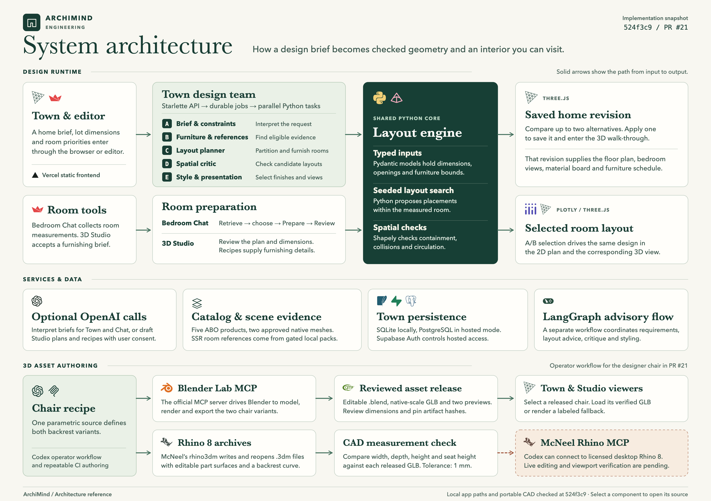

<p align="center">
  
</p>

<p align="center">
  <strong>Application and agents</strong><br />
  <a href="https://www.python.org/"></a>
  <a href="https://streamlit.io/"></a>
  <a href="https://docs.pydantic.dev/"></a>
  <a href="https://github.com/langchain-ai/langgraph"></a>
  <a href="docs/developer/TOWN.md#follow-a-design-run"></a>
</p>

<p align="center">
  <strong>Visualization and asset authoring</strong><br />
  <a href="https://plotly.com/python/"></a>
  <a href="https://threejs.org/"></a>
  <a href="https://www.khronos.org/gltf/"></a>
  <a href="docs/developer/DESIGNER_CHAIR_AUTHORING.md"></a>
  <a href="docs/developer/DESIGNER_CHAIR_AUTHORING.md"></a>
  <a href="docs/developer/RHINO_CHAIR.md"></a>
</p>

<p align="center">
  <strong>Town storage and hosting</strong><br />
  <a href="https://sqlite.org/"></a>
  <a href="https://www.postgresql.org/"></a>
  <a href="https://supabase.com/"></a>
  <a href="docs/developer/TOWN.md"></a>
</p>

<p align="center">
  <strong>Development checks</strong><br />
  <a href="https://docs.pytest.org/"></a>
  <a href="https://docs.astral.sh/ruff/"></a>
</p>

<p align="center">
  <strong>Thoughtful spaces. Structured foundations.</strong><br />
  An interior design research prototype built one verified layer at a time.
</p>

<p align="center">
  <a href="#overview">Overview</a> ·
  <a href="docs/developer/STATUS.md">Project status</a> ·
  <a href="#quick-start">Quick start</a> ·
  <a href="#models-and-coordinates">Models</a> ·
  <a href="#quality-checks">Quality checks</a> ·
  <a href="#roadmap">Roadmap</a>
</p>

---

## Overview

**Task 09A — Chat bedroom: live conversation-to-layout acceptance passed.**
Describe one measured rectangular bedroom, clarify missing measurements, explicitly
select qualified catalog products or compatible procedural templates, then
Prepare → Review → Generate synchronized A/B layouts. A fresh three-request
smoke completed a desktop request and a two-turn narrow-screen clarification;
both generated two passing seed-42 alternatives with native Belaya and an
explicitly accepted procedural queen bed. Local verification passed: 1,927 Python tests, offline installed-wheel contracts, lint, formatting, dependencies and health. Final checkpoint CI/delivery is recorded in the 09A report.
Five products are metadata qualified; Charles and Belaya are individually approved
native meshes. Mixed Charles/Belaya scenes remain placeholders. Generated 3D
assets and other live AI agents remain outside this verified milestone.
See the [chat guide](docs/developer/CHAT_BEDROOM.md) and
[current 09A evidence](docs/data/CHAT_BEDROOM_09A.md#current-09a-continuation).
The earlier November 5 storage stop remains historical evidence in that report.

To enable local opt-in chat with credentials in the ignored `.env` file:

```sh
.venv/bin/python scripts/run_chat.py --port 8502
```

### 3D Studio — procedural room concepts

The separate **3D Studio** workspace builds furnished rectangular bedrooms,
living rooms and home offices. Set room measurements and openings, propose a
furnishing plan, review its proposed dimensions, then explicitly build A/B layouts.
Python places and validates the furniture; bounded primitive recipes supply the
3D details. These are concept objects, separate from qualified catalog products.
Five [style packs](docs/developer/STYLE_PACKS.md) dress Studio rooms and Town homes
with CC0 surfaces, lighting, furniture models and decor.

Run the normal app and follow **Open 3D Studio**, or open
`http://localhost:8501/?workspace=studio`. **Load example furnishing plan → Build
3D room** works offline and uses fixed, labeled examples. Optional custom AI
creation uses server-side credentials and explicit action consent:

```sh
.venv/bin/python scripts/run_studio.py --port 8503
```

The integration adapts the Apache-2.0 part recorder from
[Spoken World](https://github.com/ryannli/spoken-world/tree/2c398a545eca4364ff6029940cecc4719c21b862).
Voice, generated JavaScript execution and its world runtime are excluded.
An authorized four-request backend smoke created three furniture recipes and two
validated alternatives; their actual Three.js bounds passed. Complete live-UI
acceptance and visual quality of model-created furniture remain unverified. See the
[3D Studio guide](docs/developer/3D_STUDIO.md) for limits and verification.


**ArchiMind AI** is an ADS 5984 software project exploring how natural-language
room requirements can become validated floor plans and interactive 3D interiors.

The long-term direction is a multi-agent design assistant. The current release
includes a working Streamlit screen, typed architectural data, strict schema
validation, an interactive 2D sample floor plan, and a reproducible developer workflow.

| **Define the space** | **Trust the data** | **See the plan** |
| :--- | :--- | :--- |
| Describe one rectangular room, its doors, windows, and furniture. | Validate dimensions, IDs, containment, collisions, doors, and circulation. | Generate two seeded alternatives and inspect the selected layout in synchronized 2D and 3D. |
| Available now | Available now | Synchronized selected views available |

> **Current stage · Styling panel and catalog-color preview POC**
>
> Generate and select bedroom alternatives in Streamlit, inspect their coordinates
> and heuristic scores, and review their spatial validation reports. The original
> Task 03 sample preview remains available, alongside clearly labeled standalone
> 3D samples. Selecting Layout A/B updates both generated views from the same
> candidate. Plotly remains the default renderer; an opt-in Three.js experiment
> now displays a room with genuine openings, shared textured chairs, and explicit
> procedural furniture placeholders. A separate LangGraph backend
> coordinates requirements, layout design, spatial critique and fixture styling.
> Requirements interpretation has an optional, disabled-by-default OpenAI path.
> Optional layout advice now runs after independent critique and before styling,
> selecting only an approved existing candidate using grounded evidence. The
> default four-node path stays deterministic; explicit opt-ins add layout advice
> and independent AI critique. The optional AI critic explains measured
> tradeoffs, supports or challenges recommendations and discloses missing evidence.
> Its feedback cannot change the selected candidate. Deterministic validation
> remains authoritative. The optional final Interior Stylist now plans catalog
> colors and finish representations through the existing E1 adapter. Fresh checks
> before and after styling preserve the selected geometry, score and reports.
> Failed AI styling uses an explicitly labeled safe fixture fallback. A checked
> plan stays separate metadata. An opt-in Plotly 3D preview maps its catalog colors
> onto existing meshes, preserving geometry. No physical materials or textures
> are applied. The panel offers fixture styling or separately
> authorized AI requests for the selected layout, with catalog themes, palette
> previews and explicit provenance. Live model behavior has not been tested.
> A full asset catalog, further agent reasoning,
> persistence, and export remain planned.
> **No API key is required for the default app, fixture styling or offline demonstrations.**

Tasks **01–06E1, 07A, 07B, 07C1, 07C2, 07D1, 07D2, 07E1, 07E2 and 07F are complete**, including the isolated architectural
room experiment and optional requirements backend. The
[project status record](docs/developer/STATUS.md) lists milestone progress,
capability boundaries, and the verified baseline. The historical Task 07F suite contained
**1,219 passing Python tests**: all 1,191 previous cases plus 28 color-preview cases,
and **27 frontend tests** covering mapping, genuine wall gaps, uniform fit,
independent instances, shared asset lifecycle, camera framing, and trusted inputs.

The header is an original concept illustration, not an application screenshot or a
generated design.

## Quick start

### 01 · Create the environment

From the directory containing your clone, use **Python 3.11+**. The local environment was configured with **CPython 3.11.13**
using `/opt/homebrew/bin/python3.11`.

```bash
cd ArchiMind
python3.11 -m venv .venv
source .venv/bin/activate
python -m pip install -e ".[dev]"
```

Create `.venv` once. For an existing environment, activate it and reinstall after
dependency changes. The editable `src/` package imports without setting `PYTHONPATH`.

### 02 · Run locally

Run these commands from the repository root. Choose the experience you want, or use separate terminals to run them together. Press **Ctrl-C** in a launcher's terminal to stop it.

| Experience | Launch command | Where to go |
| --- | --- | --- |
| Room layouts and offline 3D Studio | `.venv/bin/python -m streamlit run app.py --server.port 8501` | [Main app](http://127.0.0.1:8501) or [3D Studio](http://127.0.0.1:8501/?workspace=studio). In Studio, choose **Load example furnishing plan** and **Build 3D room**. |
| Live Bedroom Chat | `.venv/bin/python scripts/run_chat.py --port 8502` | [Chat app](http://127.0.0.1:8502). Select **Chat bedroom**, submit measurements, choose furniture, then **Prepare → Review → Generate Layouts**. |
| Live 3D Studio | `.venv/bin/python scripts/run_studio.py --port 8503` | [Studio](http://127.0.0.1:8503/?workspace=studio). Review the proposed furnishing plan before building it. |

The two live launchers read `OPENAI_API_KEY` from the server environment or the ignored root `.env` file. The offline example and the default Town walkthrough work without a key.

**Town, design worker and home editor.** With Node 20+ and the Python environment above, install the Town dependencies once and start all three components with one launcher:

```sh
npm ci --prefix frontend/realistic_viewer
.venv/bin/python -m pip install -r services/town/requirements.txt
.venv/bin/python scripts/run_town.py
```

On later launches, run only the last command. Open [Town](http://127.0.0.1:8790), select **Design a home**, and try `bright study and sage finishes`. Compare A/B, preview one, then **Apply to my home** to inspect that saved revision in the [editor](http://127.0.0.1:8791). If the launcher reports an occupied port, check the running API with `curl -fsS http://127.0.0.1:8790/health` and the editor with `curl -fsS http://127.0.0.1:8791/_stcore/health`. [Town controls and deployment guide](docs/developer/TOWN.md)

**Try the house editor.** Choose **Plan** or orbit the furnished **3D house**. Click the bedroom desk chair (or **Select desk chair**), then **Save an editable copy** on the local showcase. Type \`Pull this chair 30 cm away from the desk.\` Choose **Preview move**, read the desk gap, and **Apply move**. **Compare revisions** opens a draggable before/after from one camera. **Room photos** opens a private intake in the editor for up to four reference images and an optional measured survey. Select **Walk** to enter the home.

**Try a photographic redesign.** Open **Photo studio** to explore the recorded moss-and-brass bedroom with the comparison slider. In local Town, switch **Starting image** to **Town camera** or **My room photo** to make your own. You can also click a room in Plan or 3D and choose **Restyle room**. Enter a direction such as “keep the desk, add sage plaster and warm brass lighting,” then choose **Generate concept**. Each generation makes one OpenAI image edit using the configured server key. Compare up to three studies of the same source in the open session, drag the divider, and download a JPEG. The saved floor plan and furniture schedule remain the source for dimensions.

**Explore the example in 3D** opens the recorded furniture study without a provider call. To build your own in local Photo Studio, expand **Build a 3D layout study**, enter the room width and depth, and optionally add two more views of the same room. OpenAI identifies visible furniture. Orbit the room, drag pieces or set their coordinates, and download the editable GLB. Furniture sizes and positions are estimates. The study is separate from the saved Town home.


**Open the finished bedroom.** With the same Town dependencies, run `.venv/bin/python scripts/run_bedroom_showcase.py` instead of the Town launcher. Follow the printed link to open revision 5, walk through it, and select **Design presentation** for the plan, furniture schedule, three views and matching Blender download. This launcher uses a temporary database for your edits. [Showcase and downloads](docs/developer/BEDROOM_PRESENTATION.md)

**Tour the six-room Studio House.** Run `.venv/bin/python scripts/run_studio_home.py` with the Town dependencies above. Open the printed revision link and choose **Design presentation**. The room selector switches between the formal salon, bedroom, living room, kitchen–dining room, study and bathroom. The guide also covers the printable client book, editable Blender scene and saved chair-and-finish edit. [Studio House guide](docs/developer/STUDIO_HOME.md)

**Replay the conference home.** Open the two saved revisions of the six-room house, compare the 30 cm bedroom chair edit, and ask the chatbot which measurements support its answers. The replay guide includes a zero-API local launch, alternative ports and the revision-specific client book. The public Vercel deployment serves the static walkthrough. [Conference replay](docs/developer/CONFERENCE_REPLAY.md) · [Public walkthrough](https://archimind-town-walkthrough.vercel.app/)

#### Architecture diagram

Follow the brief through Town’s five worker roles or the room workspaces to validation and rendering. The lower panel documents the designer-chair authoring branch at `524f3c9`. Its Blender and portable Rhino CAD work belongs to [PR #21](https://github.com/ngstephen1/ArchiMind/pull/21). Live Rhino MCP verification is pending in this snapshot.

[](docs/images/ArchiMind_Architecture.svg)

### 03 · Verify the foundation

```bash
python -m pytest -q
python -m pip check
```

<details>
<summary><strong>macOS, VS Code, and later terminal sessions</strong></summary>

The recorded interpreter resolves to
`/opt/homebrew/opt/python@3.11/bin/python3.11`. Ensure `python3.11` is available on
your PATH when creating a fresh environment.

For later sessions:

```bash
cd /Users/macbook/Hack/ArchiMind
source .venv/bin/activate
python --version
```

In VS Code, select `${workspaceFolder}/.venv/bin/python` as the interpreter.

To launch without opening a browser:

```bash
python -m streamlit run app.py --server.headless true --server.address 127.0.0.1
```

</details>

## Design agent (optional)

One model chooses from four deterministic tools in a bounded loop. It can record
requirements, generate layouts, set measurable placement goals and ask for a release.
It cannot set coordinates, and only a code-only gate in
`src/archimind/design_agent/gate.py` can release a design. The gate re-runs spatial
validation, compares the design with the specification, checks requested furniture
against the user's own words, refuses tall furniture in front of a window, and
enforces required goals.

```bash
python scripts/run_with_agent.py            # reads OPENAI_API_KEY from .env, then opens the app
python scripts/eval_design_agent.py --repeat 3   # scores 8 live briefs; spends tokens
```

The panel also needs its consent checkbox ticked before any message is sent. Each
message is limited to 12 model calls, 60,000 tokens and 180 seconds. Agent traces go to
the server console under the `archimind.design_agent` logger, without message text or
keys. The existing generator and all other features work with no model and no key.

Known limits: placement wishes are enforced only when the model records them as goals,
furniture checks cover only beds, desks and wardrobes, and the model's written summary
is not verified, so trust the drawing and the approval banner over its wording.

## 2D floor plan preview

Launch the app and scroll to **2D Floor Plan Preview**. The sample contains a
5 × 4 × 2.7 m bedroom, a south-wall door, a north-wall window, a queen bed, desk,
and wardrobe. Wall gaps show openings; doors use gold dotted spans, windows use
blue spans, and furniture has readable labels and hover details.

Drag to pan, scroll to zoom, or use the Plotly toolbar to zoom and reset the view.
X/Y axes share the same meter scale. The chart uses Streamlit's supported
`width="stretch"` API.

The renderer also works independently of Streamlit:

```python
from archimind.examples import create_sample_bedroom
from archimind.render import render_floorplan

design = create_sample_bedroom()
figure = render_floorplan(design)
```

The factory returns fresh canonical Pydantic models. The renderer schema-revalidates
the design, returns a Plotly figure, and does not modify its input. Nonzero furniture
rotations raise a clear `ValueError`; rotated footprints are deferred. Out-of-room
furniture is included in the visible ranges, not hidden or declared valid. Door
swings are omitted because hinge and swing information is not part of the model.

The Task 03 sample geometry is preserved. Its caption now distinguishes the
manually specified preview from generated alternatives:

> Manually specified Task 03 demonstration. Generate and compare validated alternatives below.

The preview itself displays the fixed sample. The generator section below it
uses Task 04A/04B checks and reports validation for each generated alternative.

### Generate and compare layouts

The **AI-Assisted Room Layout Generator** section has six parts:

1. **Room Information** — the 5 × 4 × 2.7 m bedroom, bed, desk, wardrobe, south
   door, and north window.
2. **Layout Generation Controls** — random seed (default 42) and **Generate Layouts**.
3. **Generated Alternatives** — actual scores, passing status, issue/warning counts,
   generation seed/attempts, and an A/B selector.
4. **Selected 2D Floor Plan** — the existing interactive renderer and the selected
   candidate's furniture-position table in meters.
5. **Selected 3D Furnished Room** — the same selected candidate's room and furniture.
6. **Spatial Validation Summary** — containment, overlaps, door approaches,
   circulation, and any advisory warnings.

Generation happens only on the button click. Results and selection persist across
normal reruns in [Streamlit session state](https://docs.streamlit.io/develop/api-reference/caching-and-state/st.session_state).
Selecting A/B passes the exact stored `candidate.design` to both `render_floorplan`
and `render_design_3d`. There is no duplicate selected-design state or coordinate
conversion. Switching does not regenerate or spatially revalidate; existing
renderer schema checks remain in place. Editing the seed keeps the old
result and selection, with an explicit pending-seed notice. A successful generation
response replaces the stored result and selects A; a response with no candidates
clears the displayed alternatives. An exception keeps the prior result and
selection with an error message. Refreshing/disconnecting the browser may clear
the session; there is no database persistence.

No generated 2D/3D pair is shown before generation or for a normal empty/failed
outcome. A failed generation exception retains both views of the previous selected
candidate. A single available alternative is shown in both views. The standalone
sample charts remain separate demonstrations throughout.

`complete`, `search_exhausted`, `infeasible`, and `unsupported` responses are shown
explicitly. A single valid alternative is displayed on its own; search exhaustion
never claims infeasibility. Missing alternatives are never rendered. Candidate
geometry and reports are checked once on generation before storage. Scores are
placement heuristics, and the current generator uses no AI reasoning.

### Interactive 3D room structure

The **Interactive 3D Room Preview** section renders the sample room's floor and
four walls, with a south door gap and a north window at its actual sill height.
It is independent of the selected furniture alternative and contains no furniture.
The caption explicitly states:

> Structural-only preview of the fixed sample room. Independent of Layout A/B; synchronized views appear in the generator section.

Drag to orbit; scroll to zoom, or choose zoom/pan from the Plotly modebar. Use
**Reset camera to last save** to restore the initial isometric view. The scene
uses an orthographic camera and axis proportions matching width:depth:height;
a uniform framing factor leaves space for labels on narrow screens. X/Y/Z are
meters east/north/up from the southwest floor corner.

```python
from archimind.examples import create_sample_bedroom
from archimind.render import render_room_3d

figure = render_room_3d(create_sample_bedroom().room)
```

`render_room_3d(room)` returns a reusable Plotly figure without modifying the
canonical models. Floor and wall panels use [explicit mesh triangles](https://plotly.com/python/3d-mesh/).
Each wall is split at opening endpoints, and only solid vertical intervals are
triangulated. Door/window rectangles are **real holes in the wall mesh**. Window
panes are separate translucent blue surfaces; gold door outlines contain no leaf
or swing geometry. No Boolean mesh engine or new dependency is used.

All four walls support multiple openings, corner openings, shared opening edges,
and openings stacked at different heights. Positive-area overlap between openings
on the same wall raises `RoomGeometryError`. Schema-invalid rooms raise Pydantic
validation errors. Collapsed/non-finite panels, unusable scene proportions, and
more than 128 openings also raise explicit geometry errors. Decimal endpoint
arithmetic matches the canonical schemas.

This is a zero-thickness structural preview with no ceiling slab, wall reveals,
3D furniture, CAD/export, or synchronization with selected layouts. Plotly WebGL
requires browser graphics support. Browser verification observed no errors and
one non-fatal Plotly canvas readback performance advisory. Restart an already
running Streamlit server after adding renderer modules if it retains old imports.

### Interactive 3D furnished room

**Interactive 3D Furnished Room Preview** displays the fixed sample bedroom,
independently of the selected Layout A/B. It preserves the structural-only scene
and synchronized generated views above it. The generated 3D chart is labeled
**Selected 3D Furnished Room** and names Layout A or B in its caption.
Rendering alone does not establish spatial validity.

```python
from archimind.examples import create_sample_bedroom
from archimind.render import render_design_3d, render_furniture_3d

design = create_sample_bedroom()
figure = render_design_3d(design)
bed_meshes = render_furniture_3d(design.furniture[0])
```

`render_design_3d()` reuses `render_room_3d()` without changing any wall, floor,
door, or window vertices/triangles. Furniture parts are explicit Plotly `Mesh3d`
cuboids with eight vertices and twelve triangles each. Materials are muted,
opaque colors; every detail lies inside its declared bounding box.

| Appearance | Selection | Geometry |
| --- | --- | --- |
| Bed | Category `bed` | Full-footprint frame, inset mattress, two pillows |
| Desk | Category `desk` | Full-footprint tabletop and four corner legs |
| Wardrobe | Category `wardrobe`, or `storage` with name `Wardrobe` | Plinth, cabinet, two front panels, two handles |
| Generic | Other categories | One dimensionally accurate solid |

Category matching ignores case and surrounding whitespace. Furniture starts at
Z=0, preserving southwest-origin X/Y positions and metric dimensions. Only rotation
0 is supported; nonzero rotations raise `FurnitureGeometryError`. Schema errors,
collapsed/non-finite spans or face areas, and more than 100 furniture objects are
rejected explicitly. Out-of-room, overlapping, and above-ceiling objects remain
visible without relocation or any validity claim. Scene ranges include them;
axis proportions preserve equal physical units.

The furnished camera uses perspective projection with eye `(1.35, -1.65, 1.35)`
and center `(0, 0, -0.06)`. The 400 px chart replaces the previous 600 px height;
top margin is 36 px instead of 140 px. Uniform aspect proportions now use the
actual scene-span ratios, with equal physical X/Y/Z units. Geometry is unchanged.
Only the useful **Walls** legend toggle remains, and controls are arranged vertically
to keep the title readable at narrow widths. Short X/Y/Z axis titles retain meters;
directions remain east/north/up. The independent structural preview
retains its orthographic camera. Drag to orbit; select **Pan** or **Zoom** in the
modebar and drag. **Reset camera to last save** restores the initial view. Scroll
zoom is enabled, but mouse-wheel magnification was not confirmed in this browser;
use the verified modebar zoom. Hover reports name, ID, category, X/Y position,
dimensions, height, and rotation. Toggle **Walls** when a wall intercepts a furniture
hover target. Streamlit currently resets the camera to the deterministic initial
framing when A/B changes; selected data and generation results remain in session state.

Desktop (1440 px) and narrow (390 px) browser inspection checked Layout A and B
in both views, matching IDs/positions, unchanged structural meshes, readable labels,
orbit, modebar zoom, pan, and reset. The scene framing leaves the Z label visible
at narrow widths. Eight screenshots are local ignored artifacts in
`output/task06c/`. Task 06B inspection/hover screenshots remain in `output/task06b/`.
Console: no application errors; one non-fatal Plotly Canvas2D
readback performance advisory. WebGL support is required.

The sample adds 15 cuboids / 180 furniture triangles. Warm rendering measured
about 23 ms per call locally (imports excluded; this is an observation, not a CI
threshold). Task 06C adds selection synchronization and presentation adjustments
without external assets, new dependencies, geometry algorithms, schema changes,
or live Codex functionality.

### Realistic 3D Viewer — Experimental

Enable **Load experimental realistic viewer** at the bottom of the app. The default
**Architectural room** mode shows a 5 × 4 × 2.7 m room with four walls, a south
door gap, north window with glass, two real textured **Sheen Chair** instances,
and a blue desk placeholder. Orbit, zoom, pan, reset, front-wall visibility,
footprint controls, and actual coordinates are available.
It uses a separate Components V2 / Three.js viewer;
the synchronized Plotly A/B viewer remains the default and is unchanged.
This is an independent fixed sample. It does not follow automatic generation.
**Single chair (06D)** retains the original studio demonstration.

The [room implementation guide](docs/developer/REALISTIC_ROOM.md) covers the typed
contract, mesh gaps, shared resources, browser verification and limits; the
[original asset guide](docs/developer/REALISTIC_VIEWER.md) records provenance.
The GLB is **4,125,648 bytes**, by Eric Chadwick, © 2020 Wayfair, LLC,
licensed **CC0-1.0**, from
[Khronos glTF Sample Assets](https://github.com/KhronosGroup/glTF-Sample-Assets/tree/8f492390ddc7a2ae221a1369ef560589cf8c70fb/Models/SheenChair).
Its source, revision, checksum, download date, and license notices are bundled
with the asset. There is exactly one furniture GLB; no dataset is included.

Three.js 0.187.0, GLTFLoader and OrbitControls are bundled locally, with pinned
npm dependencies and a lockfile. The committed build works offline after Python
setup; Node/npm are needed only to rebuild or run frontend tests. No CDN, HDRI
download, or model API is used at runtime. The viewer preserves supplied PBR
materials and embedded textures, uses procedural environment lighting and filtered
shadows, and displays loading/error states and canonical footprint outlines.
One GLB load supplies independent chair instances. Missing assets leave the
architecture visible with explicitly labeled placeholders.

ArchiMind `(x,y,z)` maps to Three.js `(x,z,-y)`. The native Y-up model faces
canonical south. It is grounded and uniformly fitted into the declared volume
without changing canonical position/dimensions. Unused space is explicit; the
rendered detailed mesh has not passed spatial or building-code validation.

The experiment supports rotation 0 only and bounded scenes of up to 24 objects.
There is no wall thickness, door swing, or detailed-mesh validation.
It requires WebGL 2; Chromium desktop
and narrow viewport rendering were inspected. Real devices and other browser
engines remain untested. Standalone launch:

```bash
python -m http.server 8512 --bind 127.0.0.1 --directory src/archimind/_viewer_assets
```

Open `http://127.0.0.1:8512/room.html` for the room, or `/index.html` for the original
chair studio. For the full app use `python -m streamlit run app.py`.

## Deterministic workflow — backend only

Task 07A adds four future agent roles coordinated by LangGraph:
**Requirements Interpreter → Layout Designer → Spatial Critic → Interior Stylist**.
The default path runs deterministic Python code. Structured `RoomDesign` requirements
enter the existing generator; the critic independently checks each actual layout
with Shapely at zero overlap tolerance; the stylist adds explicit fixture metadata.
This structured-input path uses no LLM, live C01 request or remote tracing.

```bash
python -m archimind.examples.workflow_bedroom
python -m archimind.examples.workflow_bedroom --seed 42 --theme warm --json
```

The default sample completes with two candidates in nine attempts and returns a
typed result plus ordered activity trace. One generation iteration and four nodes
bound execution; unsupported/infeasible requests and empty search results terminate
safely. Original data is preserved; styling never moves furniture. The workflow
retains its separate backend entry point, with no persistence or automatic revision
loop. Task 07F now exposes only the existing selected-layout styling steps in
Streamlit; it does not rerun this four-role workflow or regenerate layouts.

See the [workflow guide](docs/developer/WORKFLOW.md) for contracts, failure behavior,
actual demonstration output, tests and limitations.

### Optional Requirements Interpreter — Task 07B

The [interpreter guide](docs/developer/REQUIREMENTS_AGENT.md) describes a gated
Responses API adapter with Pydantic Structured Outputs and canonical conversion.
It extracts room dimensions, supported furniture/quantities, openings, style,
constraints, preferences and ambiguities. Python converts feet to meters and
applies explicitly disclosed sample-catalog furniture defaults. Missing room or
door information requires clarification; unsupported furniture and additional
unenforceable hard constraints stop safely.

```bash
python -m archimind.examples.interpret_bedroom
python -m archimind.examples.interpret_bedroom --json
```

This CLI is **offline and mocked**: no credentials or API requests are needed.
It prepares the specified bedroom, then the unchanged generator/critic produce
two approved candidates in nine attempts. The first trace records assumptions;
the other three roles remain deterministic, including fixture styling.

Live API interpretation requires both `ARCHIMIND_ENABLE_OPENAI_REQUIREMENTS=1`
and explicit per-call authorization. LangGraph additionally requires
`interpret_free_text=True`; its default preserves 07A's prose-as-metadata behavior.
Canonical inputs always bypass the model. `ARCHIMIND_OPENAI_MODEL` selects a
documentation-verified model from the allowlist, defaulting to
`gpt-5.4-mini-2026-03-17`. No live model call was made for verification.

### Standalone Layout Designer advice — Task 07C1

The [layout-advisor guide](docs/developer/LAYOUT_AGENT.md) describes a separately
gated Responses adapter that compares existing validated candidates. It proposes
an index or abstains; it never changes geometry, reports or scores. Python computes
planar furniture-to-opening gaps and renders factual explanations. Model output
contains controlled rationale codes and existing evidence refs, preventing invented
measurements from entering the result. Preference judgments remain subjective.

```bash
python -m archimind.examples.advise_layout
python -m archimind.examples.advise_layout --json
```

This demonstration is **offline and mocked**. It proposes Layout B: its desk has
a **0 m** planar gap to the north-wall window versus about **2.532 m** for Layout A.
The original scores stay **67.614973** and **67.721925**, respectively. It makes
no daylight or ergonomic claim and still requires independent Spatial Critic
approval. `ARCHIMIND_ENABLE_OPENAI_LAYOUT=0` is the default; live use requires
explicit per-call authorization and an API key. No live request was made.

### Optional workflow recommendation — Task 07C2

The [workflow-advisor guide](docs/developer/LAYOUT_WORKFLOW.md) documents the
additional **Spatial Critic → Layout Advisor → Stylist** route. The default path
skips the advisor entirely. Workflow opt-in, the existing feature flag and explicit
per-call live authorization are separate gates. No live usage was performed.

```bash
python -m archimind.examples.workflow_bedroom
python -m archimind.examples.advised_workflow
python -m archimind.examples.advised_workflow --json
```

The comparison is **offline and mocked**, reusing the C1 fixture. Default execution
selects A/index 0 in four nodes; advised execution selects B/index 1 in five nodes
after critic approval. B retains score **67.614973**; both complete candidate
geometries, scores and critic reports are identical between runs. State records
the original choice, proposed index, grounded rationale/tradeoffs and final
selection source. Abstention/errors/rejected advice preserve the independently
approved deterministic choice and record the actual outcome. Invalid or unverified
advice cannot change the selection. The Streamlit app remains unchanged.

### Standalone AI Spatial Design Critic — Task 07D1

The [critic guide](docs/developer/SPATIAL_CRITIC_AGENT.md) documents the new
`critique_design(SpatialCriticRequest(...))` API. It reuses C1 candidate/report
grounding, verifies original scores, and adds wall-gap and scoped check evidence.
The model can reference existing facts and controlled qualitative categories;
Python verifies comparisons, IDs and recommendation consistency and renders all
measurements. At most three observations explain tradeoffs, unmet/unverified
preferences and missing information. This critic does not select or move furniture.

```bash
python -m archimind.examples.critique_layout
python -m archimind.examples.critique_layout --json
```

The **offline mock** supports B's desk/window proximity while noting A's higher
existing score and usable-space ratio. Daylight, ergonomics and desk usability
remain unverified. The default workflow still selects A; the designer's advisory
proposal stays B. Both complete candidate geometries, scores and validation
reports remain identical. This standalone demonstration preserves default routing
and is separate from the optional D2 route below. Streamlit is unchanged.

`ARCHIMIND_ENABLE_OPENAI_CRITIC=0` is the default. Live use needs the flag, exact
per-call `allow_live_usage=True`, valid bounded inputs and the existing API key/model
preflight. No live request was made.

### Optional AI critic workflow — Task 07D2

The [critic workflow guide](docs/developer/SPATIAL_CRITIC_WORKFLOW.md) describes
the new **Deterministic Critic → optional Layout Advisor → optional AI Spatial
Critic → Stylist** paths. The AI critic reviews the selected approved candidate
and accepted recommendation, if present. Support, challenge, information requests,
abstention and errors preserve that selection. Invalid output is rejected; safe
fallback uses the existing deterministic approval without claiming AI approval.

```bash
python -m archimind.examples.critiqued_workflow
python -m archimind.examples.critiqued_workflow --json
```

The **offline mocked** scenarios select A in four default nodes, B with support
in six nodes, and B with a grounded challenge in six nodes. B's original score
stays **67.614973**; all candidate geometries/scores and deterministic reports are
identical. Critic-only and advisor-only modes each use five nodes. State records
the reviewed source index, local index map, actual result/status, provenance and
failure reason. The critic has no selection-update code path.

Live critic usage requires `ARCHIMIND_ENABLE_OPENAI_CRITIC=1`, `use_ai_critic=True`
and exact per-call `allow_live_critic=True`, plus existing key/model preflight.
Disabled/unrequested critique invokes no adapter, including injected callables.
### Standalone AI Interior Stylist — Task 07E1

The [stylist guide](docs/developer/INTERIOR_STYLIST_AGENT.md) describes
`recommend_style(InteriorStylistRequest(...))`: one selected `LayoutCandidate`,
stated style/preferences and optional checked critique produce separate style
metadata. Python verifies the original spatial report/score and resolves closed
theme, palette and material IDs; no furniture, geometry or selection is changed.

Five small themes are available: **Scandinavian, Modern, Minimalist, Industrial
and Neutral**, with compatible palettes, wall/floor representations, furniture
finishes and at most three accent colors. All values come from an immutable
catalog. No arbitrary texture paths, URLs, code or performance claims are accepted.

```bash
python -m archimind.examples.style_bedroom
python -m archimind.examples.style_bedroom --json
```

The **offline mock** styles the canonical approved Layout A with warm white walls,
light oak floor/furniture representations and muted sage accents. Its original
score stays **67.721925**; complete candidate geometry, coordinates, validation
and workflow selection are identical before/after. `rendered=False` and
`physical_asset_available=False` distinguish appearance metadata from physical
assets or actual Plotly/Three.js output. The standalone demonstration remains
separate; E2 adds the optional graph route below.

`ARCHIMIND_ENABLE_OPENAI_STYLIST=0` is the default. Live usage requires exact
per-call `allow_live_usage=True`, the feature flag and existing key/model/input
preflight. No live request was made.

### Optional workflow Interior Stylist — Task 07E2

The [workflow stylist guide](docs/developer/INTERIOR_STYLIST_WORKFLOW.md) documents
`DesignRequest.style_request` and `run_workflow(..., use_ai_stylist=True,
allow_live_stylist=True)`. The existing stylist flag must also be `1`. All three
gates are required, including for explicit trusted mocks; other AI roles remain
independently opted in. Default callers retain the same four-node fixture path.

```bash
python -m archimind.examples.styled_workflow
python -m archimind.examples.styled_workflow --json
```

This permanently offline example compares A: default fixture, B: explicitly
mocked Scandinavian plan, and C: simulated timeout with fixture fallback.
Each retains Layout A, its complete geometry/reports and score **67.721925**.
AI success replaces the fixture; its plan lives at `ai_styling.result.plan`
with `source="ai"` and explicit `mode="offline_fixture"` mock provenance.
Failures retain sanitized typed errors and run the existing fixture only while
fresh deterministic approval remains safe. Unsafe selections terminate without
an approved design. At most seven nodes execute, with no retry or regeneration
for styling. JSON round-trips and all original tests are preserved.

Live API behavior, realistic material rendering and conversational UI remain
unverified or unimplemented. Task 07F now exposes the narrow styling path below.

### Selected-layout styling panel — Task 07F

After generating and selecting Layout A/B, scroll below **Spatial Validation
Summary** to **Interior Styling — Optional**. Choose **Show fixture styling** for
the existing neutral preset, with no API key or model request.

For optional AI styling, enable its checkbox, choose a catalog theme, inspect the
matching palette preview and enter optional appearance preferences. Server-side
`ARCHIMIND_ENABLE_OPENAI_STYLIST=1`, existing key/model configuration, a separate
**Authorize one OpenAI request** checkbox and an explicit request click are all
required. Consent resets after every attempt. The UI never changes environment
settings; `.env` files are not loaded automatically.

The result identifies the selected layout and distinguishes checked AI output,
mocked output, direct fixture output and fixture fallback. Failed requests retain
sanitized outcomes and permit an explicit retry without losing the layout.
Fresh spatial/specification/report/score checks reject unsafe selections. Styling
never regenerates layouts or changes coordinates, reports, scores or either viewer.

A/B switches, successful regeneration and styling-input changes clear results and
consent. Failed generation preserves the previous selection/style; changing only
the pending seed does not replace the displayed generation. All recommendations
stay separate metadata. Accepted plans offer an optional catalog-color preview
in the selected Plotly 3D view, described below.
See the [panel guide](docs/developer/INTERIOR_STYLIST_WORKFLOW.md#task-07f--streamlit-selected-layout-panel)
for API, session and fallback details. No live requests were used in verification.

### Catalog-color preview — proof of concept

An accepted style plan can recolor the selected Plotly 3D walls, floor and
furniture. **Preview catalog colors in selected 3D view** starts off and is
reversible. Geometry, camera, openings, IDs, dimensions, selection, scores and
reports stay unchanged. The 2D and experimental Three.js views keep their colors.
Fixture fallback never invents a catalog plan or activates this preview.

```bash
python -m archimind.examples.preview_style_colors
python -m archimind.examples.preview_style_colors --output output/style-color-preview.html
```

This permanently offline mock produces self-contained HTML without an API key or
CDN. It preserves Layout A's **67.721925** score and verifies geometry preservation.
One flat tint colors every part of each furniture object; accents stay metadata.
No textures, physical materials, photorealistic output, new assets or datasets
are added. See the [preview guide](docs/developer/STYLE_COLOR_PREVIEW.md).

## Models and coordinates

**One room. One consistent coordinate system. Explicit units.**

Import the public models from `archimind.models`.

| Model | What it represents |
| :--- | :--- |
| `Room` | ID, name, width, depth, ceiling height, doors, and windows |
| `Door` | ID, supporting wall, offset, opening width, and height |
| `Window` | ID, supporting wall, offset, dimensions, and sill height |
| `Furniture` | ID, name, category, position, dimensions, and stored rotation |
| `RoomDesign` | One room, its furniture list, and an optional design name |

### The spatial convention

| Convention | Meaning |
| :--- | :--- |
| Units | Meters throughout; distance fields use `_m` |
| Origin | `(0, 0)` is the southwest / bottom-left interior corner |
| Axes | X → east/right, Y → north/up, Z → vertically upward |
| Room dimensions | Width along X; depth along Y |
| Furniture position | Lower-left corner of the **unrotated** footprint |
| Furniture rotation | Stored as `0`, `90`, `180`, or `270` degrees; no transformation yet |
| North / south offsets | Measured from the west end, increasing eastward |
| East / west offsets | Measured from the south end, increasing northward |
| Opening elevation | Door bottoms at floor level; window bottoms at sill height |

### What validation guarantees

- Positive, finite dimensions and finite coordinates.
- Nonnegative opening offsets and sill heights.
- Supported walls and integer right-angle rotations.
- Openings that fit their supporting wall and the room ceiling.
- Unique IDs across the room, doors, windows, and furniture in a complete design.
- Strict input types, unknown-field rejection, and JSON serialization.

The data model can represent negative furniture positions, out-of-room furniture,
overlaps, and furniture taller than the ceiling. The separate Task 04A backend
checks planar containment and overlap for zero-rotation furniture. Task 04B adds
door approach and circulation checks through a separate combined API. Rotated
footprints and vertical furniture checks remain outside both scopes.
**Schema validity does not imply spatial validity.**

## Backend spatial validation — Task 04A

```python
from archimind.examples import create_sample_bedroom
from archimind.geometry import validate_layout

report = validate_layout(create_sample_bedroom())
print(report.status)  # passed for Task 04A's implemented checks only
payload = report.model_dump_json(indent=2)
```

`furniture_footprint(item)` and `room_footprint(room)` return Shapely polygons in
meters, using the canonical southwest origin and unrotated lower-left furniture
position. Only rotation `0` is supported. Low-level footprint helpers raise
`UnsupportedGeometryError` for unsupported rotations or geometry that cannot be
represented reliably; `validate_layout` records those conditions in its report.
The engine revalidates the input schema and preserves the original design.

| Check | Rule |
| :--- | :--- |
| Containment | Shapely `room.covers(footprint)`; wall contact is allowed; no outward buffer or area tolerance is applied |
| Collision | A unique pair collides when its intersection area exceeds the configured tolerance |
| Edge/corner contact | Zero-area contact is allowed |
| Overlap tolerance | Absolute **1e-9 m²**, configurable with `area_tolerance_m2`; set `0` for strict positive-area checks |
| Measurements | Out-of-room and overlap areas use square meters in finite JSON values |
| Numeric limits | Decimal endpoint sums avoid addition drift; collapsed, non-finite, or unreliable geometry is unverified |

Every supported pair is checked, including pairs outside the room. Issues are
ordered by unsupported geometry, containment, then overlap, with IDs sorted
lexicographically. Ordering is independent of furniture-list order.

`SpatialValidationReport` includes `room_id`, the explicit
`task_04a_containment_and_overlap` scope, `status`, `violations`, and
`area_tolerance_m2`. Each `SpatialViolation` includes `violation_type`, involved
`furniture_ids`, a human-readable `message`, and unit-named `measurements`.

| Status | Meaning |
| :--- | :--- |
| `passed` | All implemented containment/overlap checks passed |
| `failed` | Supported geometry has containment or overlap violations |
| `unverified` | Some geometry could not be checked; known violations for supported items are still reported |

Unsupported geometry takes precedence over `failed`. No design with unsupported
rotations is marked passed. Invalid canonical schemas raise Pydantic
`ValidationError` rather than producing a spatial report. Reports serialize with
`model_dump_json()` and reconstruct with
`SpatialValidationReport.model_validate_json(payload)`.

These are planar GEOS double-precision checks with an absolute area tolerance.
`validate_layout` retains its original Task 04A scope and JSON schema. Use the
combined API below for Task 04B. Neither API establishes architectural safety or
code compliance. The Streamlit generator uses the combined backend API; the
original manually specified preview remains a separate demonstration.

## Door access and circulation — Task 04B

```python
from archimind.examples import create_sample_bedroom
from archimind.geometry import (
    AccessibilityConfig,
    AccessibilityValidationReport,
    validate_accessibility,
)

report = validate_accessibility(
    create_sample_bedroom(),
    config=AccessibilityConfig(walking_clearance_m=0.6),
)
print(report.status)  # passed for this sample and these assumptions
print(report.checks["circulation"].status)
payload = report.model_dump_json(indent=2)
assert AccessibilityValidationReport.model_validate_json(payload) == report
```

`validate_accessibility` runs Task 04A and both Task 04B checks. Its report extends
`SpatialValidationReport` with `scope="task_04b_accessibility"`, the actual
configuration, and explicit results for `containment`, `furniture_overlap`,
`door_clearance`, and `circulation`. Extended issues retain the original fields
and add `door_ids` and `severity`. The original API and report remain unchanged;
deserialize combined reports with `AccessibilityValidationReport`.

| Assumption | Default and behavior |
| :--- | :--- |
| Required door approach | Opening-width rectangle extending **0.3 m** inward (`required_door_depth_m`); any positive-area furniture intrusion is a `blocked_door` error |
| Advisory approach | **0.9 m** inward (`advisory_door_depth_m`), **0.15 m** beyond each opening endpoint (`advisory_side_margin_m`); advisory-only intrusion is a `door_clearance_warning` |
| Corners | Both rectangles are clipped to the room interior; all four walls use canonical offsets |
| Contact | Boundary-only zone contact is allowed; the furniture-overlap tolerance does not hide a door obstruction |
| Walking clearance | A translating, axis-aligned **0.6 m square** (`walking_clearance_m`); room inset and obstacle expansion are each half that width |
| Usable area | Every positive-area component of the remaining occupant-center space; not the original floor area |
| Entrance | Each door's midpoint, inset by half the walking clearance; a door narrower than that clearance is inaccessible |
| Connectivity | Exactly one usable region, reachable from every door entry; separate doors do not excuse disconnected parts of a single room |
| Work bound | At most **256 furniture objects plus doors combined** for access checks; excess returns `unsupported`, preserving Task 04A results |

Door rectangles describe approach space. **No hinge, swing direction, or actual
door-swing geometry is inferred.** Every blocking furniture item is identified
per door. Advisory warnings alone do not fail an otherwise passing report.

Each check has `passed`, `failed`, `unsupported`, or `not_evaluated` status, an
explanation, and finite measurements where available. Overall `passed` requires
all four checks evaluated without errors; warnings may remain. Unknown or
unsupported checks take precedence over known failures and make the overall
result `unverified`. A room without doors has both access checks explicitly
`not_evaluated`; no entrance is invented. Unsupported rotations/numeric geometry
never become ignored obstacles in a circulation pass. Supported door blockers
are still reported when another object's footprint is unsupported.

The circulation method uses continuous [Shapely polygon difference and set
operations](https://shapely.readthedocs.io/en/stable/manual.html#set-theoretic-methods),
with no occupancy grid, sampling resolution, or snapping grid. It avoids grid
aliasing but remains a conservative proof of concept using double precision:

- The square can reject routes available to a circular body or diagonal motion.
- A blocked door midpoint can fail even if another part of a wide door is usable.
- Exact-width pinches that connect only by a line/point can be rejected. Tiny
  isolated positive-area regions also cause failure.
- Floating-point topology near tangencies can cause false positives or negatives;
  collapsed/unrepresentable geometry returns `unsupported`.
- Areas too small for the square are excluded from usable center space. This is
  not a guarantee of access to every floor patch or to each furniture function.
- Windows, furniture height, door swings, multi-room routes, and building-code
  compliance are outside scope. Only rotation `0` is supported.

Examples: the sample bedroom and an empty room with a 1 m door pass the defaults.
A cabinet in the first 0.3 m of that doorway produces `blocked_door`. A wall-to-wall
barrier produces `circulation_disconnected`; a barrier leaving a 0.5 m passage
fails the default 0.6 m clearance, while a 0.7 m alternative route passes.

<details>
<summary><strong>Field reference and validation behavior</strong></summary>

| Model | Fields |
| :--- | :--- |
| `Room` | `id`, `name`, `width_m`, `depth_m`, `ceiling_height_m`, `doors`, `windows` |
| `Door` | `id`, `wall`, `offset_m`, `width_m`, `height_m` |
| `Window` | `id`, `wall`, `offset_m`, `width_m`, `height_m`, `sill_height_m` |
| `Furniture` | `id`, `name`, `category`, `x_m`, `y_m`, `width_m`, `depth_m`, `height_m`, `rotation_deg` |
| `RoomDesign` | `room`, `furniture`, `name` |

IDs are caller-supplied nonblank strings. Furniture categories are nonblank strings;
the canonical schema remains independent of catalog metadata. Explicit catalog and
planning-envelope factories create fresh specifications. Lists default to empty,
design names to `None`, and rotations to `0`.

[Pydantic strict validation](https://docs.pydantic.dev/latest/concepts/strict_mode/)
rejects numeric strings and booleans as distances. Python integer distances are
accepted as floating-point meter values.

Opening endpoints and the ceiling may be touched. Span checks compare the decimal
representations of stored values, so `4.2 + 0.9` fits a `5.1` m wall without floating
addition roundoff or a clearance tolerance.

Models and lists are mutable. After nested edits, call
`RoomDesign.model_validate(design)` to validate the complete design again. Existing
nested model instances are revalidated; in-place edits themselves are not
automatically validated or transactional.

</details>

<details>
<summary><strong>Representative bedroom and JSON round-trip</strong></summary>

The reusable [sample bedroom](src/archimind/examples/sample_bedroom.py) constructs a
**5 × 4 × 2.7 m** room with one south-wall door, one north-wall window, a queen bed,
a desk, and a wardrobe. The original `bedroom` fixture in
[tests/test_models.py](tests/test_models.py) remains available for schema tests.

The round-trip test preserves the complete model and its data:

```python
payload = bedroom.model_dump_json()
restored = RoomDesign.model_validate_json(payload)

assert restored == bedroom
assert restored.model_dump() == bedroom.model_dump()
```

</details>

## Automatic furniture layouts — Task 05A

```python
from archimind.examples import create_sample_bedroom
from archimind.geometry import LayoutGenerationResult, generate_layout_candidates
from archimind.render import render_floorplan

requested = create_sample_bedroom()
result = generate_layout_candidates(
    requested.room,
    requested.furniture,
    seed=42,
    max_candidates=2,
    max_attempts=500,
)
for candidate in result.candidates:
    print(candidate.validation.status, candidate.score.model_dump())
    figure = render_floorplan(candidate.design)  # ordinary RoomDesign input

assert LayoutGenerationResult.model_validate_json(result.model_dump_json()) == result
```

The generator copies specifications, preserving IDs, names, categories, dimensions,
height, rotation, room, doors, and windows. It replaces only furniture positions.
Original positions are not fixed anchors; the original input objects are unchanged.
Only rotation `0` is supported. Windows/heights have no additional placement rules.

One attempt constructs an arrangement largest-footprint-first, breaking ties by
ID. A local seeded random source samples wall contacts and centimeter-rounded
interior coordinates. The existing Task 04A engine prunes failed partial layouts;
every complete candidate must pass Task 04B with **zero overlap tolerance**.
Unknown or unevaluated checks cannot be accepted. Exact position signatures remove
duplicates. The first one or two accepted arrangements are ranked by descending
score, then a stable ID/coordinate tie-break; the remaining budget is not searched
for a global optimum. Reproducibility assumes the same software versions.

The score is **80 × usable-space ratio + 20 × advisory-clearance ratio**:

- Usable-space ratio is the validator's usable occupant-center area divided by
  the empty room's inset area under the same walking clearance.
- Advisory-clearance ratio is the fraction of doors without advisory warnings.
- Ratios use 12 decimal places and totals 6. Hard violations disqualify a candidate;
  they cannot be offset by a favorable score. This is not a furniture-function,
  lighting, ergonomics, or code-compliance evaluation.

With the original **5 × 4 × 2.7 m** bedroom and seed **42**, default settings produce
two alternatives in **9 attempts**. Positions below are lower-left corners in
meters, with X east/Y north from the southwest origin. All rotations are zero.

| Furniture ID | Width × depth × height (m) | Original (x, y) | Layout A (x, y) | Layout B (x, y) |
| :--- | :--- | :--- | :--- | :--- |
| `queen-bed` | 1.6 × 2.0 × 0.6 | (0.4, 1.4) | (3.4, 1.69) | (1.96, 0.0) |
| `desk` | 1.2 × 0.6 × 0.75 | (3.2, 3.2) | (0.0, 1.36) | (3.74, 3.4) |
| `wardrobe` | 1.5 × 0.6 × 2.0 | (3.4, 0.4) | (0.0, 3.4) | (0.0, 3.4) |

Both alternatives pass all four spatial checks and have no advisory warnings.
Layout A: usable ratio **0.596524064171**, advisory ratio **1.0**, score
**67.721925**. Layout B: usable ratio **0.595187165775**, advisory ratio **1.0**,
score **67.614973**. These are heuristic alternatives, not optimal designs.

Run the complete example workflow (original specification plus alternative
coordinates, reports, and score components). JSON goes to stdout or `--output`;
runtime/status go separately to stderr so the JSON stays reproducible:

```bash
python -m archimind.examples.generate_bedroom
python -m archimind.examples.generate_bedroom --seed 42 --output /tmp/archimind-bedroom-layouts.json
```

| Result status | Meaning |
| :--- | :--- |
| `complete` | Requested one or two distinct passing candidates found |
| `search_exhausted` | Fewer candidates found within the budget; any valid alternatives are retained; no proof of infeasibility |
| `infeasible` | A necessary condition fails: oversized zero-rotation footprint, excess total footprint area, or unusable empty-room door/clearance |
| `unsupported` | Nonzero rotation, missing/unevaluable entrance, numeric limits, or object-count limit |

`max_attempts` defaults to 500 and accepts 0–10,000; `max_candidates` accepts 1 or 2.
Generation supports at most **32 furniture objects**, also respecting Task 04B's
256 combined furniture/door limit. Each attempt performs at most N partial
validations and one complete validation, plus one empty-room preflight per call.
Results include attempts used, rejection counts, seed, actual clearance config,
and structured candidates. Invalid schemas/options raise validation errors.

An empty furniture request has exactly one distinct arrangement: requesting two
returns that layout with `search_exhausted`. Searches can miss feasible placements
because of finite sampling, centimeter rounding, fixed rotation, ordering, or the
Task 04B conservative assumptions. There is no minimum visual difference rule
beyond distinct exact coordinates, and no optimality or architectural compliance
claim. Task 05B exposes these same results in Streamlit alongside the Task 03 preview.

## Technology

### In the project today

| Layer | Technology | Purpose |
| :--- | :--- | :--- |
| Language | Python 3.11+ | Application and package |
| Interface | Streamlit 1.66.1 | Sample previews, seeded layout comparison, selected 2D/3D views, and AppTest utilities |
| Data | Pydantic 2.14.1 | Room, opening, furniture, and design schemas |
| Visualization | Plotly 7.1.0 | Metric 2D plans and structural/furniture 3D meshes from canonical models |
| Spatial geometry | Shapely 2.2.0 | Zero-rotation furniture containment and overlap checks |
| Backend orchestration | LangGraph 1.2.18 | Bounded default workflow and optional post-critic recommendation |
| Optional model adapters | OpenAI SDK 3.40.0 | Separately gated requirements, layout advice, design critique and standalone style planning; mock-verified |
| Town persistence | SQLite locally, PostgreSQL in hosted mode | Saved projects, revisions and worker jobs |
| Testing | pytest 9.1.1 | Smoke, model, renderer, and preview integration tests |
| Code quality | Ruff 0.17.3 | Linting and formatting |
| Packaging | build 1.6.1 + setuptools | Wheel and source distributions |

Streamlit, Pydantic, Plotly, Shapely, LangGraph and OpenAI are runtime dependencies. pytest, Ruff, and build are
development extras. Required transitive dependencies install automatically;
future tools are not added to project requirements prematurely.

### Planned for later phases

| Capability | Proposed technology |
| :--- | :--- |
| Further agent reasoning | Existing LangGraph + OpenAI backend |
| 3D export | Trimesh |

## Quality checks

The test suite covers package imports, the Streamlit screen and chart, schema
validation, wall/ceiling limits, opening and furniture coordinates, equal-scale
axes, containment, collisions, door zones on every wall, corner entrances,
circulation barriers and alternative routes, missing/multiple doors, tolerance behavior, unsupported geometry,
seeded generation, bounded failures, ranked alternatives, button-driven UI state,
A/B selection, seed changes, failure messages, actual 3D wall-triangle coverage and
opening gaps, input immutability, IDs, and lossless JSON
round-trips. Tests run without an API key or external model service.

```bash
python -m ruff check .
python -m ruff format --check .
python -m pip check
python -m pytest -q
python scripts/check_health.py
python -m build
```

`check_health.py` selects an available local port, starts a real headless Streamlit
server, checks for HTTP `200` / `ok`, and stops its temporary server.

### Every change, checked

[GitHub Actions CI](https://github.com/ngstephen1/ArchiMind/actions/workflows/ci.yml)
runs on pull requests targeting `main` and pushes to `main`, with manual runs
available too. Feature-branch pushes are checked through their PR to avoid
duplicate branch/PR runs. One Linux/Python 3.11 job installs dependencies once.

| Gate | What runs |
| :--- | :--- |
| Code quality | Ruff linting, import ordering, and formatting |
| Dependencies | `python -m pip check` |
| Application | All tests, including Streamlit, geometry, seeded generation, and comparison state |
| Runtime | A real headless Streamlit server must return HTTP `200` / `ok` |

Actions use pinned revisions, read-only repository permissions, and cancellation of
superseded runs. The extra OS/Python matrix, distribution builds, archive/wheel
checks, and artifact uploads were removed from routine CI for this local prototype.
Packaging remains available manually with `python -m build`. Hosting deployment
is not configured.

<details>
<summary><strong>Application tests, formatting, and manual server checks</strong></summary>

Smoke tests check imports from outside the repository without `PYTHONPATH`, package
metadata, branding, the preserved sample, and generated-layout comparison through Streamlit's
[AppTest](https://docs.streamlit.io/develop/api-reference/app-testing/st.testing.v1.apptest).
AppTest does not start a network server.

Apply formatting with `python -m ruff format .`. Build outputs in `dist/` are
ignored by Git.

For a manual server check, start the headless app and run this in another terminal:

```bash
curl --fail http://127.0.0.1:8501/_stcore/health
```

Adjust the port to match Streamlit's printed URL. A healthy response is `ok`.
Stop the server with `Control-C`.

</details>

## Repository map

```text
ArchiMind/
├── .github/workflows/ci.yml      Lint, dependency, test, and app-health checks
├── app.py                       Streamlit entry point
├── src/archimind/
│   ├── __init__.py               Package initialization
│   ├── models/
│   │   ├── __init__.py           Public model exports
│   │   ├── room.py               Room, Door, Window, RoomDesign
│   │   └── furniture.py          Furniture representation
│   ├── geometry/
│   │   ├── __init__.py           Public footprint/validation APIs
│   │   ├── footprints.py         Zero-rotation Shapely polygons
│   │   ├── accessibility.py      Door approach and circulation checks
│   │   ├── layout_generator.py   Bounded seeded placement and scoring
│   │   └── validator.py          Scoped, deterministic spatial reports
│   ├── render/
│   │   ├── __init__.py           Public rendering function
│   │   ├── floorplan_2d.py       Metric, interactive Plotly floor plan
│   │   ├── room_3d.py            Structural meshes with real opening gaps
│   │   ├── furniture_3d.py       Bounded furniture cuboids and hover information
│   │   └── design_3d.py          Furnished scene composition
│   ├── ui/
│   │   ├── __init__.py           Public Streamlit presentation helper
│   │   └── layout_generation.py  Button-driven generation, state, and comparison
│   ├── agents/
│   │   ├── interior_stylist_agent.py    Standalone gated style adapter
│   │   ├── interior_stylist_catalog.py  Immutable appearance tokens and palettes
│   │   ├── interior_stylist_grounding.py  Layout verification and style resolution
│   │   └── interior_stylist_schemas.py  Strict requests/proposals/metadata
│   ├── workflow/
│   │   ├── __init__.py           Public workflow API with optional gated advice
│   │   ├── state.py             Typed requests, handoffs, critiques, trace and result
│   │   ├── graph.py             LangGraph conditional orchestration and error guards
│   │   ├── layout_recommendation.py  Approved-only C1 handoff and safe fallback
│   │   ├── spatial_critique.py   Read-only D1 handoff, provenance and safe fallback
│   │   ├── interior_styling.py   E1 final handoff, fresh approval and fixture fallback
│   │   ├── selected_styling.py   Verify/style existing A/B selection without generation
│   │   └── nodes.py             Requirements, generation, critique and fixture styling
│   └── examples/
│       ├── __init__.py           Public example factory
│       ├── sample_bedroom.py     Reproducible canonical-model bedroom
│       ├── generate_bedroom.py   Original request and generated-alternatives CLI
│       ├── workflow_bedroom.py   Default offline result/trace/JSON demonstration
│       ├── advised_workflow.py   Default versus advised comparison using a mock
│       ├── critiqued_workflow.py Default, supported B and challenged B mocks
│       ├── style_bedroom.py      Standalone catalog style mock, unchanged layout
│       └── styled_workflow.py    Fixture, mocked style plan and safe fallback
├── tests/
│   ├── test_smoke.py             Package and application checks
│   ├── test_models.py            Model tests and bedroom fixture
│   ├── test_floorplan_2d.py      Coordinate and preview integration tests
│   ├── test_geometry.py          Backend containment/collision/report tests
│   ├── test_accessibility.py     Door/circulation/configuration/report tests
│   ├── test_layout_generator.py  Seeded alternatives, scores, bounds, and renderer tests
│   ├── test_layout_generation_ui.py  AppTest controls, selection, state, and error cases
│   ├── test_room_3d.py           Coordinates, wall triangles, gaps, and 3D integration
│   ├── test_furniture_3d.py      Bounds, surfaces, dimensions, and numeric limits
│   ├── test_design_3d.py         Scene composition, 2D correspondence, and app preview
│   ├── test_layout_sync.py       Selected object identity, matching geometry, session states, and framing
│   └── test_workflow.py          Offline orchestration, critiques, isolation and CLI tests
├── scripts/check_health.py      Temporary server health check
├── docs/
│   ├── assets/                  README artwork and logo badges
│   └── developer/STATUS.md      Milestones, capabilities, and verification record
├── .env.example                 Future configuration placeholder
├── .gitignore                   Local/generated-file exclusions
├── MANIFEST.in                  Source archive contents
├── pyproject.toml               Package metadata and dependencies
└── README.md
```

## Product facts and conservative planning envelopes

The independent furniture catalog now contains five metadata-qualified ABO products
(schema 2, release 1.1.0). Its original two-product release 1.0.0 remains packaged
for explicit historical research replay.
Task 08C-R1 adds an explicit backend-only Policy B API for the Charles armchair:
`furniture_from_planning_envelope()` returns a fresh canonical item plus immutable
source/inspection/version evidence. Published dimensions, measured mesh bounds,
reserved planning dimensions and the new item's canonical dimensions remain
distinct. `furniture_from_catalog()` still uses the original published dimensions.

The native-scale box is reserved conservatively before explicit generation;
existing layouts, validators and scores are unchanged. There is no automatic
clearance margin or mesh scaling. Task **08C-R2** separately qualifies the original
Charles GLB for native-scale rendering in an isolated experimental room. Enable
**Load experimental realistic viewer → Charles product (08C-R2)** to see two
real armchairs and a labeled desk placeholder. This does not follow or resize
A/B candidates. Published dimensions and historical catalog/planning flags remain
unchanged; a digest-bound render release records the completed visual gates.
See the [planning-envelope guide](docs/developer/PLANNING_ENVELOPES.md) and
[product rendering guide](docs/developer/CHARLES_PRODUCT_RENDERING.md) for exact
coordinates, CC BY 4.0 attribution, resource budgets, packaging and limitations.

## Selected-layout realistic view

Generate alternatives, select Layout A or B, then choose **Realistic Three.js**
under **Selected 3D Furnished Room**. The 2D plan stays visible. Plotly remains the
default; all views use the same stored candidate, with no generation, spatial
validation or rescoring on a view change. A/B switches preserve the Three.js
camera and cutaway controls; Reset fits the current layout.

The default procedural bedroom shows labeled bed, desk and wardrobe placeholders.
Charles or Belaya is used only with an explicit, current planning sidecar; matching a
category or size is insufficient. The separate **Charles product (08C-R2)**
demonstration now passes deterministic fixture validation and exercises the same
adapter. Styling colors remain a Plotly preview; Three.js retains source materials.
See the [selected-layout guide](docs/developer/SELECTED_REALISTIC_LAYOUTS.md)
for API/state contracts, verification and known limits.

## Catalog-sized specifications

> Belaya end-to-end browser acceptance passed on November 1, 2026 (R3B5). The accumulated workflow and viewer-lifecycle changes are now recorded in this checkpoint. See the [qualification report](docs/data/ASSET_QUALIFICATION_BELAYA_08F3A.md#r3b5--final-same-session-browser-regeneration-acceptance) for historical browser evidence and the appended R3C reconciliation.

Choose **Specification for next generation → Catalog selection** to retain or
remove the procedural items and optionally add one of each catalog product:
Charles armchair, Espresso bookcase, Belaya writing desk, Morava wardrobe and
Rivet nightstand. Use **Prepare new specification → Review → Generate Layouts**.
Pending edits leave displayed results and styling unchanged; generation uses the
reviewed dimensions and freezes its submitted specification/provenance.

Charles and Belaya reserve their separately approved Policy B envelopes and can
use their native-scale meshes in single-product scenes. Belaya reserves exactly
1.6 × 0.8018731772899628 × 0.7516312003135682 m; its published 1.6 × 0.8 × 0.75 m
measurements remain separate. Missing planning evidence disables preparation.
The bookcase, Morava and nightstand remain published-sized placeholders.
A combined Charles/Belaya scene reports **mixed scene not yet qualified** and
uses placeholders for both products; the resource budget is unchanged.
Published measurements are checked claims, not independent physical measurements. Compatible Charles or Belaya instances offer a mesh/placeholder display
choice; no rendering choice resizes or revalidates the layout. Plotly stays the
default. See the [catalog workflow guide](docs/developer/FURNITURE_CATALOG_UI.md)
for exact dimensions, provenance, failure policy, state and verification.

## Furniture source expansion and owner review

Task **08F1** added 25 source-research candidates while preserving all 32 historical
records. Three new source-qualified leads cover a desk, a wardrobe and a nightstand;
no reviewed bed qualifies. That historical checkpoint retained two active products.
Task **08F2** admits those three exact leads as metadata, bringing the active catalog
to **five products**. At that historical checkpoint Charles was the only render-qualified product. No model
was acquired and no embedding was rebuilt. Source qualification does not prove
native envelope containment or scene resource compatibility. The [expansion findings](docs/data/FURNITURE_EXPANSION_08F1.md)
include exact evidence and a [blank 24-prompt owner-review packet](docs/data/FURNITURE_RETRIEVAL_HUMAN_REVIEW_08F1.md).
Independent relevance review remains pending. See the [08F2 admission report](docs/data/FURNITURE_CATALOG_ADMISSION_08F2.md)
for exact IDs, dimensions, version boundaries and verification.

## Offline semantic retrieval experiment

Task **08R1** benchmarks one pinned BGE-small encoder through FastEmbed on local
CPU files, exact NumPy cosine and rank-only RRF. It adds no search UI, live model
service or default dependency. The conservative real threshold missed all eight
held-out positives; raw cosine found them but returned products on four negatives.
RRF did not improve real recall over BM25. Semantic retrieval remains experimental.
See [measured results, model hashes and reproduction](docs/data/RETRIEVAL_EMBEDDING_08R1.md).
The normal app works without FastEmbed, ONNX Runtime or a model cache.

## Offline furniture retrieval baseline

Task **08R0** provides strict immutable search contracts, current catalog/rights/
dimension/qualification filters, deterministic Python keyword ranking and an
optional in-memory SQLite FTS5 comparison. Retrieval returns qualified IDs and
evidence; it does not select products in Streamlit, generate layouts or fetch models.
The default fit check uses the actual generation reservation, not a smaller
published box. Preparation consumers re-resolve results against current evidence.

The offline benchmark separates **38 real queries over two products** from
**24 synthetic queries over eight artificial products**. Both real lexical
baselines have recall@2 **0.90**, with zero observed hard-filter violations or
unauthorized IDs in this small fixture set; both miss two semantic paraphrases.
Judgments are agent-authored, not independent expert evaluation. No vector model
was tested and no embedding dependency was added. See the
[architecture guide](docs/developer/FURNITURE_RETRIEVAL_ARCHITECTURE.md) and
[actual benchmark findings](docs/data/RETRIEVAL_BASELINE_08R0.md).

Run `python scripts/evaluate_furniture_retrieval.py --historical --output /tmp/08r0-results.json`
with the project virtual environment. The output must be a new filename; the tool
constructs only an in-memory historical index and downloads no model. Omitting
`--historical` rejects these frozen two-product judgments against the active
five-product corpus. Old lexical/vector snapshots remain stale for application
resolution. A new five-product effectiveness study needs explicit snapshot
construction and human-reviewed judgments; no such study or 08R2 UI is implemented.

## Roadmap

See [project status](docs/developer/STATUS.md) for the detailed capability matrix
and verification record.

- [x] **Task 01 · Foundation** — package, environment, Streamlit screen, smoke tests.
- [x] **Task 02 · Core data models** — room, openings, furniture, schemas, JSON.
- [x] **Task 03 · 2D floor plan visualization** — interactive canonical-model preview.
- [x] **Task 04A · Spatial validation backend** — containment and furniture overlaps.
- [x] **Task 04B · Door clearance and walking-path validation** — bounded backend approximations.
- [x] **Task 05A · Deterministic furniture layout generation** — validated backend alternatives.
- [x] **Task 05B · Streamlit generation and comparison** — A/B plans, scores, validation, and session state.
- [x] **Task 06A · Basic interactive 3D room geometry** — structural room meshes and real wall openings.
- [x] **Task 06B · 3D furniture visualization** — bounded meshes and independent furnished sample.
- [x] **Task 06C · Synchronize Selected 2D and 3D Layouts** — one stored candidate supplies both views; compact furnished camera framing.
- [x] **Task 06D · Realistic 3D Asset and Renderer Proof of Concept** — one licensed textured chair, local Three.js bundle, isolated opt-in component.
- [x] **Task 06E1 · Realistic 3D Architectural Room Foundation** — canonical room scene, true wall openings, shared chair instances, labeled placeholders, independent opt-in demo.
- [ ] **Task 06E2** — separate proposed rendering work: curated asset bindings and room interaction.
- [x] **Task 07A · LangGraph Workflow Foundation** — backend-only, deterministic requirements/design/critique/styling nodes, bounded execution and typed trace; no LLMs.
- [x] **Task 07B · OpenAI-Backed Requirements Interpreter Agent** — optional gated Responses extraction, evidence/catalog conversion, clarification, typed failures and mocked verification; live behavior unverified.
- [x] **Task 07C1 · OpenAI-Powered Layout Designer Agent** — standalone, default-off candidate recommendation with grounded facts, immutable layouts and mocked verification.
- [x] **Task 07C2 · LangGraph Layout Designer integration** — optional post-critic selection, grounded provenance, safe deterministic fallback and offline demonstration.
- [x] **Task 07D1 · Standalone AI Spatial Design Critic** — evidence-grounded support/challenge, preference tradeoffs, abstention and mocked verification.
- [x] **Task 07D2 · AI critic graph integration** — optional traced review after deterministic approval/advice; challenge never switches selection.
- [x] **Task 07E1 · Standalone Interior Stylist agent** — controlled catalog metadata, verified selected layout, conflicts/clarification and mocked verification.
- [x] **Task 07E2 · Interior Stylist workflow integration** — optional final E1 node, fresh approval, immutable selected data and explicit fixture fallback.
- [x] **Task 07F · Streamlit styling panel** — selected-layout handoff, catalog theme/preferences, one-request authorization and clear fixture/AI provenance.
- [x] **Task 08B · Qualified furniture metadata** — two immutable product records, published dimensions and explicit catalog factory.
- [x] **Task 08C / 08C-R · Inspection and dimension review** — Charles native mesh measured; published-envelope rendering rejected; source discrepancy and policy options documented.
- [x] **Task 08C-R1 · Approved planning-envelope contract** — explicit backend-only Policy B, one Charles metadata reference, immutable evidence and fresh specification factory; no product render approval.
- [x] **Task 08C-R2 · First native-scale product** — one Charles GLB qualified and packaged, isolated two-chair scene, verified fallbacks and legacy compatibility.
- [x] **Task 08D · Selected-layout Three.js** — exact selected A/B geometry, a Plotly/Three.js selector, explicit product evidence and honest placeholders.
- [x] **Task 08E · Catalog-sized specifications and selection** — explicit preparation/review, catalog-sized generation, frozen provenance and compatible display choices; no implicit resizing.
- [x] **Task 08F1 · Source shortlist and human-review preparation** — three new source-qualified leads, preserved historical evidence and blank review forms; active catalog unchanged.
- [x] **Task 08F2 · Metadata admission** — five qualified catalog records with separate published, planning and rendering evidence.
- [x] **Task 08F3A through R3B5 · Belaya workflow and browser acceptance** — approved Policy B generation, native-scale selected A/B views, same-session regeneration and owner-scoped camera persistence.
- [x] **Task 08F3A-R3C · Release verified** — [delivery CI passed](https://github.com/ngstephen1/ArchiMind/actions/runs/42127832828) for `a38a2e1`: 1,867 Python and 91 frontend tests. Packaging, installed contracts and browser evidence are reconciled for the bounded prototype.
- [x] **Task 08R1 · Offline embedding/hybrid benchmark** — one isolated CPU encoder, frozen development/held-out judgments and measured abstention trade-offs; production integration deferred.
- [x] **Task 08R0 · Offline retrieval contract and baselines** — current hard filters, keyword/FTS5 comparison, isolated synthetic fixtures and auditable metrics; no vector database or UI wiring.
- [ ] Export.
- [ ] Multi-agent collaboration and targeted design revisions.
- [ ] Versioned persistence and a reproducible offline demonstration.

Later phases remain proposed work. This prototype does not provide CAD/BIM outputs,
construction guidance, or building-code/accessibility certification.

## Town AI design team

**Design a home → Generate** runs two OpenAI agents in parallel for the brief and styling. Once Python validates the candidate layouts, OpenAI reviews their floor-plan images. Animated cards identify the engine, task and recorded results. The local worker can ask Codex CLI for a bedroom placement critique using its own login. See the [Town guide](docs/developer/TOWN.md#follow-a-design-run) for setup, budgets and rendering a concept illustration from a saved revision.

## Configuration and project boundaries

The [Codex Design Advisor](docs/developer/CODEX_ADVISOR.md) provides local single-user placement suggestions through the Town launcher. Town uses the server-side OpenAI key for its design team. The local Town, Chat and Studio launchers read it from the environment or ignored `.env`. Codex CLI uses its own login. Browsing and viewing saved layouts require no model request.

Local virtual environments, secrets, caches, databases, generated renders, and
temporary outputs are excluded from Git.

This repository documents software implementation. The separate course
Requirements & Architecture assignment remains outside this development work.

---

<p align="center">
  <strong>ArchiMind AI</strong><br />
  <sub>Define carefully. Validate explicitly. Build incrementally.</sub><br />
  <sub><a href="docs/assets/README.md">Artwork &amp; logo credits</a> · <a href="#overview">Back to top ↑</a></sub>
</p>
