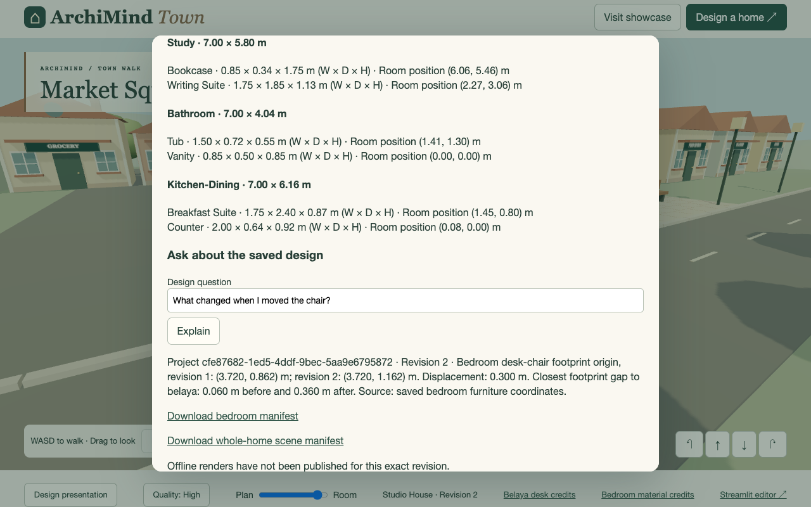

# Town design evidence for the November 21 conference run

The saved bedroom chair moved 0.300 m away from its desk. The answer panel reports the two footprint origins and the clearance change. It asks for the clear width between the desk supports and the floor-to-underside height before claiming that the chair slides underneath.

## Reopen the two revisions

1. Use the Town database containing project `cfe87682-1ed5-4ddf-9bec-5aa9e6795872`. The project link requires that database. The original [revision 1 manifest](https://github.com/ngstephen1/ArchiMind/blob/ccf9ab12f6b6d908c27f7628079aea5829c91b5a/docs/data/conference-sprint/before.json) and [revision 2 manifest](https://github.com/ngstephen1/ArchiMind/blob/ccf9ab12f6b6d908c27f7628079aea5829c91b5a/docs/data/conference-sprint/manifest.json) allow independent verification without the database.
2. Run `.venv/bin/python scripts/run_town.py` from the repository root. Open the local Town URL printed by the launcher, adding `?project=cfe87682-1ed5-4ddf-9bec-5aa9e6795872&revision=2`.
3. Open **Design presentation**. Scroll to **Ask about the saved design**, enter “What changed when I moved the chair?” and choose **Explain**. Revision 1 can be reopened by changing the final URL parameter to `1`.
4. Ask “Will this chair slide under the desk?”, “Why is the bedroom desk near this window?” and “Which pieces have an oak finish?” Ask the window question without specifying a room to see the app distinguish the bedroom and study desks.

| Saved evidence | Revision 1 | Revision 2 |
|---|---|---|
| Whole-home manifest SHA-256 | `2f50b4194433484014d91df723601c9dbe7f93b914f44bbbc1fe1aa1fa03fb42` | `51730091069609ac32035ef80b113974ae1d32f448f073479ccf1cdc92d313d2` |
| Chair footprint origin (room-local metres) | (3.720, 0.862) | (3.720, 1.162) |
| Closest footprint edges, `desk-chair` and `belaya` | 0.060 m | 0.360 m |
| `belaya` to `bedroom-window`, center to center in plan | 4.46 m, west wall | 4.46 m, west wall |
| Verified finish | Belaya catalog variant = Oak | Belaya catalog variant = Oak |

The footprint measurement does not establish clearance for knees or chair arms. The window measurement supports a proximity statement. The record contains no screen-glare measurement or reason for the desk placement. The catalog variant identifies a finish label and does not certify solid-oak construction.

The browser exercised the ordinary Town UI built from `3ac65d7e984f92ba6b2d0d4469a8397e29076f0a` against the saved project in SQLite. Six questions on each revision matched the independently calculated values or the expected missing evidence. The only API calls made by the page were one GET on revision 1 and two GETs on revision 2, including its preceding revision. These are agent-operated browser observations. [Revision 1 transcript](browser-r1.json) · [Revision 2 transcript](browser-r2.json)

## Six design scenarios

Run `.venv/bin/python -m pytest -q tests/test_town_conference_scenarios.py` and `node --test frontend/realistic_viewer/tests/town_explanation.test.js`. The Python cases substitute deterministic structured model responses and invoke Town's real interpreter, candidate generator and validator. Candidates remain previews until explicitly applied. These tests measure downstream behavior with a given interpretation. They do not estimate how often a live model will interpret new phrasing correctly.

| Scenario | Result |
|---|---|
| Hosting dinners | Two validated homes ranked the smaller kitchen–salon center distance first, 8.305 and 8.334 m. |
| Working from home | Two validated homes ranked the larger study–living center distance first, 12.846 and 12.500 m. Acoustic performance is unmeasured. |
| Lock the bedroom | Both alternatives preserved origin, dimensions, openings and furniture in the locked bedroom. |
| Style-only edit | One Japandi candidate kept all six rooms' geometry, openings and positions. |
| Ambiguous furniture lock | The interpreter asked which room contains the desk and yielded zero candidates. |
| Mandatory second storey | Town reported the unsupported requirement and yielded zero candidates. |

The input home was unchanged in all six cases. The machine-readable matrix records prompts, expectations, observations, candidate IDs and revision effects. [Scenario matrix](scenario-matrix.json)
