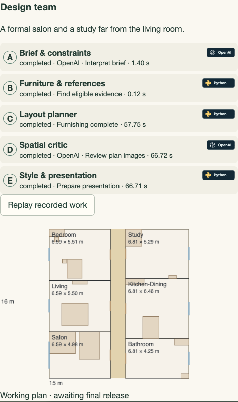

# A fresh conference home from a live brief

On November 21, 2026, Town used the original local design-job ledger and a new empty project, `c9339e4f-a57a-4328-95dc-40dc36dd5b89`. The operator approved two additional team jobs. The browser submitted the original compound brief, then one clarification. The first job reported unsupported requirements for the requested narrative and the dining capacity. The second completed with two validated homes on a 15 × 16 m lot, seed 42. Its brief was “A formal salon and a study far from the living room.” The 4-seat salon does not accommodate two hosts and four guests for dinner.

OpenAI completed the second interpretation, styling direction and candidate plan-image review. Python handled the lot and reachable geometry. The optional Codex CLI bedroom critique failed. The [agent events](agent-events.json) give the exact per-task outcomes and ordering. [First job](submitted-1.json) · [Second job and both candidate identities](submitted-2.json).



The browser applied Layout A as revision 1 and used **Preview pulling chair out 30 cm → Apply furniture to my home** for revision 2. Each manifest came from **Design presentation → Download whole-home scene manifest**. Each snapshot contains the corresponding saved home from SQLite. The matching seed and interpretation reproduced the earlier project's two home IDs. The project ID and manifest hashes identify this separate live run.

| Revision | Whole-home export SHA-256 | Saved snapshot SHA-256 |
|---|---|---|
| 1 | `fdd06c258b4756298c546f23d501aeb677ceb1be8bbd2f7106f100c5263d889a` | `677521ee988f4313acf62ef6692d92f4ef1ee80277800c8fbb516dfc47c2cfee` |
| 2 | `f02b4ea3bf609253ae0b320a6a4059286f3a69bef58816476570f7038fd36118` | `c5f67ff7256a60a2ef8199e03dd1b3864b97f794ac3151d232b24ac39a96f247` |

The standard Town answer panel identified the revision, chair and desk. Their footprint gap grew from 0.060 to 0.360 m. The bedroom desk remained 4.46 m from the west window midpoint measured center to center. The Belaya catalog variant is Oak. Verifying under-desk fit still requires the underside height and clear width between desk supports. The saved record supplies no evidence of glare or placement rationale. [Revision 1 answers](chat-r1.json) · [Revision 2 answers](chat-r2.json).

The six existing scenarios reran through the real spatial validator with deterministic provider outputs. All six passed, as did the eighteen JavaScript evidence tests. This browser run exercised two real briefs and eight evidence answers. External reviewers can inspect the receipts independently of the private development database.

## Reopen and verify both projects

The portable replay contains two projects, four saved revisions, and zero jobs or events. An ordinary-browser repeat on all four revisions reproduced the four answers on each and captured three bedroom views each. The fresh project's [before](doorway-r1.jpg) and [after](doorway-r2.jpg) views share the same doorway camera. Its desk preset reframes the subject after the chair moves.

A release operator with access to the original Town database can build the sanitized edition using the shared export command. Supply a new output filename.

```sh
TOWN_SOURCE="${TOWN_DB:-$PWD/output/conference-sprint/home/town.sqlite3}"
.venv/bin/python scripts/export_town_replay.py "$TOWN_SOURCE" Conference-Town.sqlite3 docs/data/conference-sprint docs/data/conference-live-final && \
  ARCHIMIND_ENABLE_OPENAI_STUDIO=0 TOWN_DB="$PWD/Conference-Town.sqlite3" .venv/bin/python scripts/run_town.py
```

Use the Town link printed by the launcher and append `?project=c9339e4f-a57a-4328-95dc-40dc36dd5b89&revision=2`. Set the revision to 1 for the earlier chair position. Visitor playback can run with live generation disabled. The [four exported board digests](replayed-manifests.json) reproduce the actual browser exports from the source DB. The distributed SQLite SHA-256 is `a2fc081830eae29e325cfe0189ba545b6d5b37557e7df2a7961946e27db010ea`.

The [sanitized original ledger](ledger.json) records all five submissions on the UTC day, including the three that preceded the extra grant. It distinguishes the 15 reserved calls from actual provider billing.
