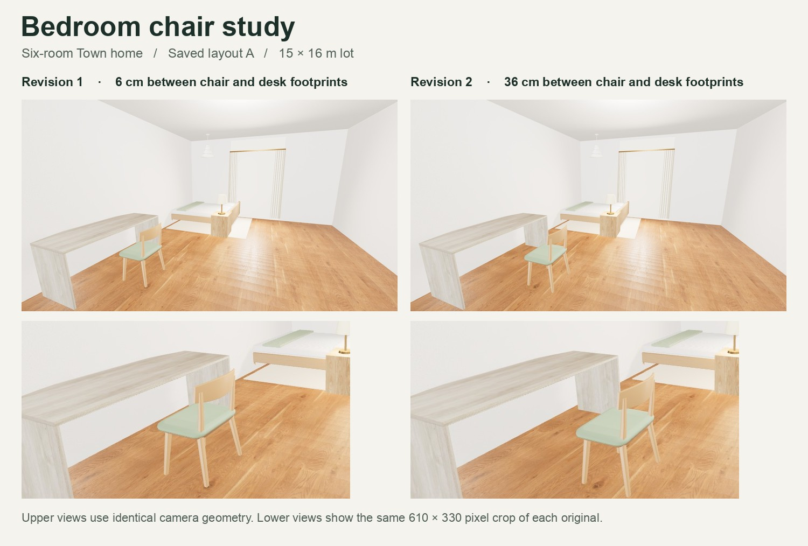

# Fresh Town home for the conference

ArchiMind generated this six-room home from a live request on November 21, 2026. The first two interpretations failed. The third request, “A formal salon and a study far from the living room,” produced two validated alternatives on a 15 × 16 m lot with seed 42. Nguyen’s demonstration uses Layout A. The daily job limit then rejected a request to move the writing chair. Town’s explicit preview and apply controls subsequently saved a validated 30 cm move as revision 2 with zero additional model calls.



## Source and identity

Project ID `cfe87682-1ed5-4ddf-9bec-5aa9e6795872`. Town generated and applied the first layout at `3748d08645004b50a85eaf2e48f83507890a9df7`. The chair preview and apply ran with the backend from `48ede3bdea81a19a808c6e28516ed00ff126e2a6` and the corrected browser bundle from `c27db6c7956cad58db8f6f7b630949795cfa4b2a`. Both revisions came from the same initially empty local SQLite database. The project and revision identify the records within that database. The manifests provide portable access.

| Revision | Client export | Home ID | SHA-256 of exported bytes |
|---|---|---|---|
| 1 | [before.json](before.json) | `7672311c0dd5a54aa3196d1b17f9800b14de60d4dab2e52f146d8503b81d6a6a` | `2f50b4194433484014d91df723601c9dbe7f93b914f44bbbc1fe1aa1fa03fb42` |
| 2 | [manifest.json](manifest.json) | `a592e2dd3793a64774d9c8ecc57ce4a4c5685cbb75aa8c6d1caed5a8a995c7c6` | `51730091069609ac32035ef80b113974ae1d32f448f073479ccf1cdc92d313d2` |

## What changed

Both exports came from **Client presentation → Download whole-home scene manifest**. Compare `bedroom.furniture` using stable IDs and room-local coordinates in metres.

| Bedroom object | Revision 1 | Revision 2 |
|---|---|---|
| `desk-chair` footprint origin (x, y) | (3.720, 0.862) | (3.720, 1.162) |
| `belaya` footprint origin (x, y) | (3.160, 0.000) | (3.160, 0.000) |
| Edge-to-edge chair-to-desk gap | 0.060 m | 0.360 m |
| `bedroom-window` on the west wall | Offset 1.753 m, width 1.400 m | Offset 1.753 m, width 1.400 m |
| Nearest plan distance from the desk footprint to the window segment | 3.300 m | 3.300 m |

The saved home objects differ in exactly three fields: the chair’s y coordinate, the home ID, and the new chair-move evidence. The chair-to-desk measurement is the shortest distance between their axis-aligned footprints. The desk and chair overlap on x. Subtract the northern edge of the desk from the southern edge of the chair on y. The window distance uses the shortest 2D distance to the opening segment. Desk underside clearance, glare, daylight performance and measured acoustics remain unknown.

The browser exported all four original JPEGs. Both [revision 1](doorway-r1.jpg) and [revision 2](doorway-r2.jpg) doorway views have identical eye, aim and field of view. The comparison sheet adds the same unscaled crop from each doorway view. The separate desk presets reframe the subjects automatically. Their views of [revision 1](desk-r1.jpg) and [revision 2](desk-r2.jpg) have different camera positions.

## Agent outcomes

The [live job receipt](live-jobs.json) records all three submitted briefs, reported states, timestamps and final candidate identities. It omits provider credentials and operator identifiers. The first brief asked for an explanation in the layout schema, and the second specified four dining seats. Both failed interpretation. The successful request completed live interpretation, styling and the OpenAI plan-image review. Agent D recorded six reachable rooms for each candidate. The optional Codex CLI bedroom critique returned a process error. Reference dataset retrieval was disabled for this run. The successful interpretation recorded a relative distance preference between study and living room.

## Reproduce the comparison

From the repository root, run the following commands. Validate the hashes above before rendering a book or replaying evidence queries.

```sh
cd docs/data/conference-sprint
shasum -a 256 before.json manifest.json
jq '.bedroom.furniture[] | select(.id=="desk-chair" or .id=="belaya") | [.id,.footprint_xy_m,.reservation_wdh_m]' before.json manifest.json
jq '.bedroom.cameras[] | select(.id=="doorway")' before.json manifest.json
```
