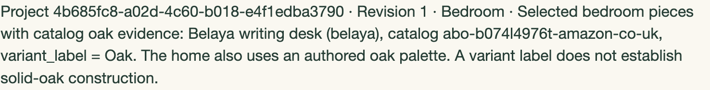
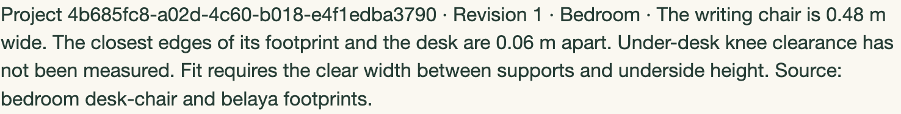

# Fresh-home decision sheet · revision 1

**Decision:** Retain A as the baseline for review. Its study begins at the rear of the home, across the hall from the social rooms. B puts the study and formal salon at the front, on opposite sides of the hall. This difference can be read from the plan; the run supplies no acoustic measurement.

| Client question | Candidate A | Candidate B |
| --- | --- | --- |
| Where can two people work? | Bedroom Belaya desk and separate study writing suite | Same two work areas; study is at the front |
| Can the hosts seat four guests for dinner? | Four documented salon dining places; two more seats at the same table remain unresolved | Same four-place salon program |
| What supports the study choice? | Study origin (8.449, 10.262) m; salon origin (0, 0) m | Study origin (8.319, 0) m; salon origin (0, 0) m |

Both alternatives reported six reachable rooms, 2.5 m of study window width and 0.50 m salon chair withdrawal. A ends in home ID `65d2792b389a11270304f5167a458a724dde892308bb185fc3e46e2f98e99b09`; B is `3a637d13a1f7b0d6bbf7fa84c24d820071a3ef28046e115f460b20fcd6a12ff6`.

## Execution and handback

- Runtime checkout at launch: `559a0a1`; 15 × 16 m, seed 42, fresh local SQLite project `4b685fc8-a02d-4c60-b018-e4f1edba3790`.
- The first [runbook brief](../../developer/FRESH_HOME_CLIENT_DEMO.md) reached the live team under job `03270213-49bb-4039-9100-fc072959da2e`. A failed interpretation: the supported priorities cannot express a quiet study. E completed its styling task. B retrieved evidence, C inspected the lot, and D checked starting geometry while A was active. No live candidate was produced.
- The separate offline clarification “formal salon and bright study” yielded A and B. Applied A via the local Town API, reopened revision 1, and exported with the same whole-home serializer used by the browser. [Manifest](before.json) · [Hieu’s handoff issue](https://github.com/ngstephen1/ArchiMind/issues/32).
- A subsequent chair-only request retained the bright-study priority and failed validation. Its corrected submission received HTTP 429. The local operator has a three-job limit per UTC day. Resume in the **same database and project** after reset, with current width/depth and palette and the neutral priority. Preserve the original revision. Export revision 2 and append its link and digest to the issue after successful Apply.
- Once the edited proof exists, run `python3 scripts/check_home_handoff.py before.json after.json proof/receipt.json` with paths to the actual exports. Verify the movement visually in the saved walkthrough, dimensioned plan and rendered bedroom. The baseline book alone cannot close this check.

## Browser evidence

The saved bedroom returned Belaya’s Oak variant from its verified product record. Its desk center was 4.16 m from the nearest west-wall window center. The chair reservation was 0.48 m wide and the footprint gap was 0.06 m. Verifying under-desk fit requires a clear opening width and underside height. The screenshots below were captured from the same revision.

