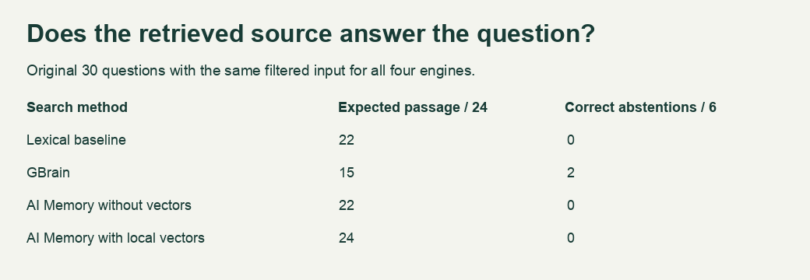

# AI Memory retrieval decision

**Keep Town on its current retrieval path.** Local embeddings found the expected passage for 24 of the 24 answerable questions with the filtered input. They returned passages for all six questions where the library lacked evidence. For the physical chair-load question, the first result was the Deep chair’s digital CAD measurement. Every returned ID resolved to a reviewed passage. Relevance to a chair does not establish a load rating.



## Results

Each cell gives two counts: expected source among the first three, then empty results on unsupported questions. The original set has 24 answerable and six unsupported questions. The additional set has six answerable and four unsupported questions.

| Questions and query input | Lexical | GBrain | AI Memory without vectors | AI Memory with local vectors |
|---|---:|---:|---:|---:|
| Original, filtered | 22 / 0 | 15 / 2 | 22 / 0 | 24 / 0 |
| Original, property retained | 22 / 0 | 5 / 6 | 21 / 0 | 23 / 0 |
| Additional, filtered | 5 / 1 | 3 / 1 | 6 / 1 | 6 / 1 |
| Additional, property retained | 4 / 0 | 0 / 4 | 6 / 0 | 5 / 0 |

The predeclared original-set thresholds are at least 21 correct sources, six correct abstentions, valid citations and an improvement over simpler retrieval. Neither AI Memory configuration passed the combined gate. The additional cases were committed before running either configuration. They are a small within-project check, not independent external validation. No Town adapter, browser rollout, or model-generated answer was activated.

## Method

The real v3.5.0 MCP service indexed twelve reviewed passage titles and bodies in a disposable public-only project, separate from developer handoffs. The local-vector arm verified all three upstream-pinned all-MiniLM-L6-v2 files, backfilled all twelve pages, and checked that the vector stream actually participated in search. No OpenAI key, cloud reranker, or GPU was used. The benchmark maps returned page paths to the ArchiMind manifest and discards service-generated snippets.

Every engine received the same token sequence within each condition. Filtered input uses the existing public design vocabulary. The second condition preserves all alphanumeric words of these synthetic questions, including properties such as warranty and fire resistance. It also preserves ordinary filler words, so differences cannot be attributed solely to property retention. The second condition is for these public fixtures only.

An empty list is the operational definition of abstention. Retrieving a relevant topic and deciding whether a passage supports a specific claim are different tasks. Before repeating the adoption decision, evaluate a separate property-and-unit support check on fresh questions. For a load-test claim, require a load-test record. A mesh measurement alone is insufficient.

In the Mac run, median retrieval was about 2 ms without vectors and 9 ms with local vectors on the already-running service. The public data directory occupied approximately 5.1 MB or 96.5 MB including model files. GBrain started a CLI process per query and took approximately 0.65 s, while in-process lexical ranking took under 1 ms. These timings include different process lifecycles and exclude installation and initial indexing.

## Reproduction

Use an editable ArchiMind checkout, GitHub CLI access for binary acquisition, and Python 3.11+. The model download is approximately 87 MB and its files are verified before use. Keep loopback port 49485 free.

```sh
.venv/bin/python scripts/dev_memory.py install
.venv/bin/python -m archimind.design_evidence install
.venv/bin/python -m archimind.design_evidence build
.venv/bin/python scripts/benchmark_ai_memory.py /tmp/archimind-ai-memory-results.json
```

[Per-question IDs, active retrieval streams and timings](../data/AI_MEMORY_RESULTS.json) · [Public passage manifest](../../data/design_evidence/sources.json) · [Additional frozen questions](../../data/benchmarks/design_memory_holdout.tsv) · [Developer handoff guide](DEV_MEMORY.md)
