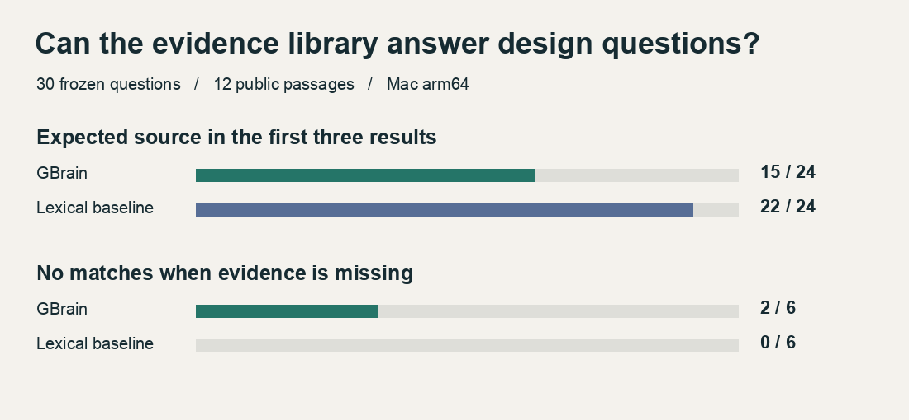

# Local design evidence pilot

**Decision — keep GBrain available for developer lookup.** Town rollout requires 21 of 24 correct top-three results, six of six abstentions, and a demonstrated advantage over the simpler search. The November 18 pilot missed each quality target. No Town feature flag or dependency is necessary to run the existing application.



## Results

| Measure | GBrain keyword search | TF-IDF on the same passages |
|---|---:|---:|
| Expected passage in the first three, 24 answerable questions | 15 | 22 |
| Empty result, six questions lacking evidence | 2 | 0 |
| Answerable questions missed | 9 | 2 |

Both engines received the same filtered terms, 12 passage titles and excerpts. The benchmark selected the expected passage ID before implementation. One expected passage per question makes this a strict retrieval measure. A different relevant passage may score as a miss. A correct passage ID alone does not establish that a generated answer would address every part of a question. An empty result is the pilot's operational measure of abstention. No answer-writing model participated.

Town's existing Agent B returned catalog matches on 14 of 30 questions with external reference packs disabled. Its outputs identify products, matched terms and listing URLs. They have a different unit of evaluation from a passage retrieval score. The JSON contains the actual catalog results for every row.

- GBrain found the Deep chair seat measurement, the salon GPU, and the published book identity.
- It missed the published width/depth question for Belaya. It returned CAD measurements for a physical load-test question and a product specification for a price question. These matches do not support those claims.
- The allowlisted query vocabulary protects private free text, but can discard the actual property being asked about. “Retail price” disappears from the Charles query. Evaluate a query representation that retains requested properties and checks whether the source supplies them on a **new held-out set** before connecting answers to Town.
- Median end-to-end Mac lookup was **0.741 s**, including process launch and binary verification. One installed index occupied about **66 MiB**. This covers one small public corpus on one machine.

[Per-question results](../data/GBRAIN_PILOT_RESULTS.json) · [Frozen questions](../../data/benchmarks/design_evidence.tsv) · [Reviewed passages](../../data/design_evidence/sources.json)

## Run in a developer checkout

Use ArchiMind's editable Python 3.11+ environment. The installer supports Apple Silicon macOS and x86-64 Linux and requires GitHub CLI access to public releases and attestations. Only installation needs network access. Use the following from the repository root.

```sh
.venv/bin/python -m archimind.design_evidence install
.venv/bin/python -m archimind.design_evidence build
.venv/bin/python -m archimind.design_evidence search "How high is the Deep chair seat?"
```

Codex and Claude can use the same search command. A result is a public reference passage, source hash and commit-pinned citation. Inspect the cited lines before using them in a design explanation. For private project geometry and window positions, consult the currently selected Town revision. The pilot's library has no private revisions or measured glare values.

The library uses the allowlisted Git sources in the checkout. Each passage and source file is hashed. To update a source, review its lines, source hash and citation revision together and rebuild. A failed rebuild preserves the active pointer. When source identity changes, existing lookups fail closed until a matching index is available. Successful rebuilds leave prior directories available to in-flight readers. Once readers finish, superseded `index-*` directories can be removed after checking the directory named in `active.json`. The local binary and indexes live under `~/.local/share/archimind-gbrain`; set `ARCHIMIND_EVIDENCE_HOME` to use a dedicated directory elsewhere.

## Verification

```sh
.venv/bin/python -m pytest -q tests/test_design_evidence.py
.venv/bin/python scripts/check_design_evidence.py
.venv/bin/python scripts/benchmark_design_evidence.py /tmp/archimind-gbrain-results.json
```

The integration check needs the pinned baseline Git object. It compares the reviewed sources with that object, builds two indexes, exercises simultaneous readers, removes a passage in a third build, and checks persisted files for a synthetic private marker. macOS validation ran with network access denied. The Linux job acquires the binary before running the same checks in an isolated network namespace. The benchmark uses synthetic questions and the existing local catalog. Browser tests for client-facing answers are deferred until the retrieval gate passes.

The locked release is GBrain `v0.60.737.0` at `291b7996a4e2881acc921b1085d818bb9640f5d0`. Acquisition verifies the platform SHA-256 and the release workflow's GitHub attestation. Indexing runs in a dedicated directory with an isolated home, embedding disabled, transcript archiving off, and an explicit import directory. A query sends up to 12 terms from public design vocabulary to GBrain. Upstream search bookkeeping can retain those terms. Model keys and application environment variables stay out of the child process. [Release](https://github.com/garrytan/gbrain/releases/tag/v0.60.737.0) · [MIT license](../third-party/GBRAIN-LICENSE.txt)
