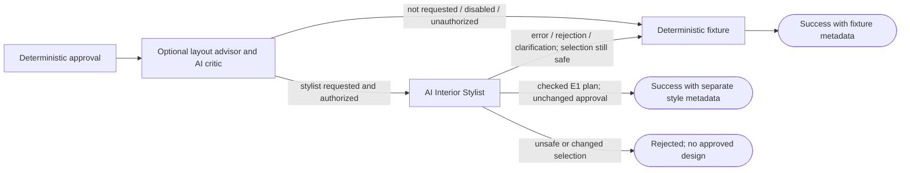

# Optional workflow Interior Stylist — Task 07E2

E2 reuses the [E1 adapter, catalog and grounding](INTERIOR_STYLIST_AGENT.md) as
an optional final LangGraph node. The default four-node workflow remains offline,
with the same neutral/warm/cool fixture palette and selected geometry. Task 07F
adds the selected-layout Streamlit panel below. A separate optional
[color preview](STYLE_COLOR_PREVIEW.md) consumes accepted plans in the selected
Plotly 3D chart; the full four-role workflow stays a separate backend API.

## API and authorization

`DesignRequest.style_request` is optional bounded text (400 characters). An
explicit value takes precedence over a ready Requirements Interpreter's stated
`extraction.style.text`. Additional preferences use the existing `soft_preferences`
handoff. Missing style details remain missing; no theme is inferred from the fixture
selector or original prose. Only an evaluated/abstained, checked D2 critique is
forwarded; failed critiques are not presented as evidence.

`run_workflow` adds three keyword-only parameters:

| Parameter | Default | Meaning |
| --- | --- | --- |
| `use_ai_stylist` | `False` | Explicitly request the final E1 styling step |
| `allow_live_stylist` | `False` | Exact boolean consent forwarded as E1's `allow_live_usage`; required for every E2 invocation, including trusted mocks |
| `interior_stylist` | `None` | Optional trusted Python test fixture; production uses the existing `recommend_style` adapter |

The existing `ARCHIMIND_ENABLE_OPENAI_STYLIST=0` flag stays disabled by default.
Both `use_ai_stylist=True` and flag value `1` and `allow_live_stylist=True` are
required to invoke the node. This task exercised that path **only with mocks**.
The E1 adapter separately checks API authentication, model allowlist and bounds.
An injected callable is trusted application code, not an untrusted-code sandbox.
Other agents retain their independent modes, flags and authorization.

This example is permanently offline because the client behind the injected
example function is always mocked:

```python
import os
from unittest.mock import patch

from archimind.examples import create_sample_bedroom
from archimind.examples.style_bedroom import offline_interior_stylist
from archimind.workflow import DesignRequest, run_workflow

request = DesignRequest(
    specification=create_sample_bedroom(),
    style_request="Scandinavian bedroom with warm white walls, light oak furniture, and muted sage accents.",
)
with patch.dict(os.environ, {"ARCHIMIND_ENABLE_OPENAI_STYLIST": "1"}):
    result = run_workflow(
        request,
        use_ai_stylist=True,
        allow_live_stylist=True,
        interior_stylist=offline_interior_stylist,
    )
assert result.ai_styling.result.mode == "offline_fixture"
assert result.ai_styling.result.plan.rendered is False
```

## Routing, results and fallback



`WorkflowState.ai_styling` carries requested/status/executed/source, the original
candidate index, E1's checked `InteriorStylistResult` and a sanitized reason.
The plan is at `ai_styling.result.plan`; it is not copied into canonical geometry.
On AI success `source="ai"`, `status="styled"`, and legacy `styling` is `None`.
Read `result.mode` and `model` for provenance: `offline_fixture`/`None` means mocked
output, not a real model response. `executed` means adapter invocation, not proof
of live usage. The activity trace includes the mode, target, source and outcome.

| Outcome | Workflow behavior |
| --- | --- |
| Not requested | Same four default nodes; `not_requested`, `executed=False`, fixture source |
| Feature disabled | No AI node/call; `disabled` / `feature_disabled`; labeled fixture |
| Missing consent | No AI node/call; `unavailable` / `authorization_required`; labeled fixture |
| Valid checked plan | AI node replaces fixture; `styled`, separate E1 plan; successful terminal state |
| Missing style / model clarification | Checked `needs_clarification` result retained; no plan; fixture fallback |
| Authentication / timeout / provider failure | Typed E1 code retained with sanitized messages; no AI plan; safe fixture fallback |
| Invalid catalog, IDs, context or provenance | `rejected` / `invalid_style`; no AI plan; safe fixture fallback |
| Unsupported/bounded stylist input | `rejected` / `invalid_input` before adapter; fixture only if selection is still spatially safe |
| Unsafe/stale/changed selected geometry, score or report | Terminal rejection; selected/approved design cleared; no fixture fallback |

Fallback is the existing deterministic fixture, **never fabricated AI output**.
Its `source="deterministic_fixture"` is stored in both `ai_styling` and `styling`.
The original failed/clarification status and safe error remain auditable; workflow
success in this mode means required deterministic checks plus fixture styling
completed, not that AI styling succeeded. Provider text/context is discarded on
failure. No retry, revision or automatic request to another agent is performed.

Default execution stays four nodes. AI success also replaces the fixture in four
nodes, plus one for each separately opted-in advisor/critic. AI failure adds the
fixture after the attempted node: at most **seven** nodes total, one generation
iteration, and recursion backstop **9**. Every optional node runs at most once.

## Geometry and serialization boundary

Before invocation, E2 requires the existing accepted review and selected candidate
to agree, then reruns the existing accessibility check at zero overlap tolerance
with the request's config and verifies the existing score helper's result. E1's
preparation and interpretation perform their existing independent checks too.
Requests are copied deeply. After invocation, E2 compares the entire authoritative
handoff (request, working design, generation, reviews, selected index/source,
approved design and prior advice/critique) and repeats fresh verification.
Reports/scores are compared, never replaced or recomputed into workflow state.

E2 revalidates the result and matches its exact context to the selected input,
then reconstructs it through E1 grounding. Forged catalog colors, palette/material
references, unknown IDs, altered explanations and provenance are rejected.
Missing/unverified generation or selection cannot reach successful styling.

JSON round-trips preserve E1's immutable tuple catalog. The workflow retains its
strict Python schemas and upgrades older JSON states to fixture provenance when
legacy styling is present. No checkpointer, persistence, external callback or
remote LangSmith tracing is enabled.

## Offline verification and limits

```bash
python -m archimind.examples.styled_workflow
python -m archimind.examples.styled_workflow --json
python -m pytest -q tests/test_interior_styling_workflow.py
```

Scenarios A/B/C use identical Layout A, geometry, IDs, dimensions, rotations,
complete reports and original score **67.721925**. A uses the fixture; B returns
explicitly mocked Scandinavian `scandi_warm_sage` choices with warm white walls,
light oak floor/furniture and muted sage accents; C simulates a timeout and runs
the labeled fixture. B is four nodes, C five; no live client can be selected by
this example's CLI. The standalone E1 demo remains available.

The integration suite blocks DNS/socket connections and real client construction.
It covers all gates, canonical grounding failures, fresh-check failures, invalid
handoffs, safe fallback, other optional roles, immutability, isolated deterministic
runs, strict JSON and CLI output. No live model behavior or quality is verified.

Plans remain **metadata only** (`rendered=False`, no physical assets). No realistic
materials, geometry changes, conversational UI, persistence or
automatic revision is implemented. The catalog's small vocabulary and E1's
preference/geometry limits remain. Task 07F exposes only selected-layout styling,
not conversational input, other AI agents, revisions or material rendering.

## Task 07F — Streamlit selected-layout panel

Generate alternatives, choose **Layout A** or **Layout B**, and scroll below its
spatial validation summary to **Interior Styling — Optional**. The selected
candidate continues to supply the existing synchronized 2D/3D views.

- **Show fixture styling** is always available for a passing selection. It uses
  the existing neutral fixture, with no API key or model invocation. It is a preset;
  AI theme/preferences do not control its ivory/slate/natural-oak suggestions.
- **Enable AI-assisted styling** starts unchecked. When enabled, choose a catalog
  theme (default Neutral), inspect its matching palette preview and optionally
  enter up to 400 characters of appearance preferences. Choices come from the
  existing immutable catalog; its current one-palette-per-theme structure is
  displayed read-only rather than as a redundant selector.
- AI requests also require server configuration, a separately checked
  **Authorize one OpenAI request** control, and an explicit **Request AI styling**
  click. The toggle alone authorizes nothing. Consent is consumed before invocation
  and reset after each attempt; retrying requires fresh consent and another click.

The server must receive the existing stylist flag, API key and allowlisted model
through its environment. `.env` files are **not** automatically loaded. The panel
does not enter/display keys or environment values and cannot change feature flags.
When the feature is unavailable, AI submission is disabled while the fixture
remains usable. Other AI flags never enable additional roles through this panel.

```bash
cd /Users/macbook/Hack/ArchiMind
source .venv/bin/activate
python -m streamlit run app.py
```

Results identify the selected layout and original score, with one of these sources:

| Display | Meaning |
| --- | --- |
| Deterministic fixture — AI was not requested | Explicit offline preset action |
| AI stylist — API response | Checked E1 output with `mode="api_response"` |
| Mocked AI stylist — offline fixture | Trusted test/example injection; never a live quality claim |
| Deterministic fixture fallback | AI unavailable, rejected, failed or needing clarification; its outcome remains visible and no AI plan is fabricated |

Accepted plans show theme/palette, wall/floor representations, furniture-ID finish
assignments, accents, preference notes and limitations. Catalog colors are metadata,
not physical material rendering. The optional catalog-color preview is a separate
explicit step in the selected Plotly 3D view. Fixture and fallback output have no
catalog finish plan and retain the original colors.
Raw exceptions, provider diagnostics, credentials and full request/context payloads
are not displayed. Recoverable failures retain the current layout for another
explicit request; unsafe candidates receive no approved styling result.

### Selected-layout API and session behavior

The public `style_selected_layout(request, generation, selected_candidate_index,
*, use_ai_stylist=False, allow_live_stylist=False, interior_stylist=None)` returns
the existing `WorkflowState`. It reuses deterministic critique, E2's shared fresh
verification and guarded E1 handoff, and the existing fixture node. It never calls
generation, the full `run_workflow`, Requirements Interpreter, Layout Advisor,
AI critic or Codex. `selection_source="user_selection"` distinguishes the caller's
original A/B index from automatic ranking; prior provenance rules remain intact.

The complete input generation result, candidate ordering, geometry, reports and
scores are preserved. Only actual verification/styling steps are traced; generation
iteration count remains zero. Fixture requests receive fresh checks too. Failed,
unknown, stale or altered checks/scores cannot be repaired by fixture output.

Styling lives in separate per-session state, bound to the specification, stored
generation, selected index and submitted inputs. A/B switches, successful
regeneration and styling-input changes clear results and consent. Switching back
does not restore old results. A failed generation preserves the previous result,
selection and associated styling. Editing the pending generation seed leaves the
displayed generation/style intact; requests use its original seed/configuration.
Normal reruns and view/input changes make no styling or spatial-validation calls.

Only button submissions enqueue work. Pending requests are consumed once, guarded
against in-flight duplicates and discarded if their binding is stale. No shared
model-response cache, persistence, automatic retry or background worker is added.
Refresh/disconnect can clear the browser session.

```bash
python -m pytest -q tests/test_interior_styling_ui.py
python -m pytest -q tests/test_layout_generation_ui.py tests/test_layout_sync.py
```

All AI verification uses mocks. The real app's default/fixture path, mocked AI
presentation, desktop/narrow controls and stale-result behavior are checked without
live API usage. Real account availability and recommendation quality remain unverified.
