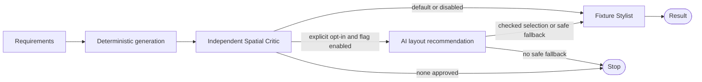

# Optional layout recommendation in LangGraph — Task 07C2

The default workflow stays deterministic. An explicit opt-in can add the existing
[C1 Layout Designer](LAYOUT_AGENT.md) **after independent Spatial Critic approval
and before fixture styling**. It selects an existing candidate only. Geometry,
IDs, dimensions, heuristic scores and validation reports are preserved.
Streamlit and the renderers do not invoke this backend workflow.



Only conditional outgoing edges are used on routing nodes. The stylist alone has
a static edge to END. There is one generation iteration, no back edge or advisor
retry, at most **four default/five advised nodes**, and a recursion backstop of 7.
Generation, requirements and critique failures preserve existing termination.

## API and state

```python
from archimind.examples import create_sample_bedroom
from archimind.workflow import DesignRequest, WorkflowState, run_workflow

request = DesignRequest(
    specification=create_sample_bedroom(),
    seed=42,
    soft_preferences=["Place the desk closer to the north-facing window."],
)
result = run_workflow(request)  # four nodes; no advisor invocation
assert result.selected_candidate_index == 0
assert result.selection_source == "deterministic"
assert WorkflowState.model_validate_json(result.model_dump_json()) == result
```

`run_workflow` adds `use_ai_layout=False`, `allow_live_layout=False` and optional
trusted callable `layout_advisor`. Flags must be actual booleans. Callers cannot
select a callable through request text. Requirements interpretation keeps its
independent gates. Explicit request preferences take precedence; otherwise ready
07B extraction preferences are inherited. No preferences, or more than C1's eight
supported preferences, skips advice with an explicit reason.

The root state adds `selection_source` and one `LayoutRecommendationState`:

| Field | Meaning |
| --- | --- |
| `requested` / `status` | Opt-in and actual eligibility/outcome: not_requested, pending, disabled, skipped, recommended, abstained, unavailable, error or rejected |
| `executed` | Adapter invocation occurred; does **not** imply a live model request |
| `deterministic_candidate_index` | Original first critic-approved generator candidate |
| `proposed_candidate_index` | Parseable proposed original index, including a rejected proposal when safely mappable |
| `candidate_indices` | Advisor-local → original generator index map |
| `advice` | Checked existing `LayoutAdviceResult`, including rationale, facts, tradeoffs and limitations; typed failures retain sanitized codes |
| `reason` | Eligibility, abstention or sanitized failure/rejection reason |

`selected_candidate_index` remains the final original generator index.
`approved_design` is copied from that original candidate, and the stylist receives
it. Additive defaults preserve old request/state JSON; old selections infer
deterministic provenance. Strict downstream consumers must allow the new fields.

## Approval and failure behavior

1. The critic independently checks each actual candidate, its specification and
   supplied report, using the existing spatial engine at zero overlap tolerance.
2. The advisor receives a copied **approved-only** candidate packet. When a
   rejected candidate is removed, that derived packet describes its own subset;
   original generation metadata, candidates and critic reports remain in state.
   For example, only original index 1 approved means advisor-local 0 maps to 1.
3. Existing C1 `prepare_layout_context` rechecks the supplied packet and computes
   facts. C2 compares the returned context exactly, reuses C1
   `interpret_layout_proposal`, and requires the entire grounded result to match.
   Altered coordinates, reports, scores, measurements, explanation, provenance,
   indices or evidence cannot become an accepted recommendation.
4. A valid proposal selects only an independently approved original candidate.
   No regeneration or coordinate application follows selection.
5. Abstention, typed API errors, exceptions and rejected advice retain the
   deterministic selection **only while its authoritative approval still agrees**.
   With no safe fallback the workflow stops. Fallback always has source
   `deterministic`, never `ai_recommendation`. No raw provider/exception message
   is stored on error; actual status and sanitized code remain available.

The structured trace records critic approval/eligibility, adapter execution,
proposal mapping, acceptance or fallback and selection source. Accepted advice
also records `offline_fixture` or `api_response` provenance and rationale code.
No timestamps, credentials, raw provider payloads or remote LangSmith tracing are
added. Dependency injection is trusted Python code, not a security sandbox.

## Gates and verification scope

Real API usage requires all of these: `ARCHIMIND_ENABLE_OPENAI_LAYOUT=1`,
`use_ai_layout=True`, `allow_live_layout=True`, and the existing API key/model
preflight. The environment flag defaults to 0. Disabled or unrequested advice
takes the four-node path with **zero adapter invocations, including DI**.

An explicitly injected offline fixture may execute with live authorization false,
but still needs workflow opt-in and the flag. Its accepted result must say
`offline_fixture` with model `None`. An API result must carry the configured
allowlisted model and explicit live authorization. Provenance checks detect
inconsistent metadata; they cannot attest arbitrary trusted injected code.

**No live OpenAI or C01 request was made for this task.** Tests block socket
connection/DNS attempts and mock clients, including successful structured parsing
and timeout paths. Live model quality, latency, cost and account availability
remain unverified. C1 retains its fixed endpoint, timeout, zero automatic retries,
bounded inputs/output and no-tools policy; no API adapter logic was duplicated.

## Reproducible offline demonstration

```bash
python -m archimind.examples.workflow_bedroom
python -m archimind.examples.advised_workflow
python -m archimind.examples.advised_workflow --json
```

The second CLI reuses C1's existing mocked advisor with provided candidates; the
advisor never regenerates. It temporarily scopes/restores fixture settings and
always uses a mocked client. It exposes no live mode and needs no credentials.
Each comparison run independently generates the same canonical 5 × 4 m bedroom
with seed 42, two candidates and nine attempts:

| Run | Selection | Original score | Source | Nodes |
| --- | --- | --- | --- | --- |
| Default | A / index 0 | 67.721925 | deterministic | 4 |
| Offline mock | B / index 1 | 67.614973 | ai_recommendation, offline_fixture | 5 |

Desk-to-north-window planar footprint gap is **2.532114 m** for A and **0 m** for B.
Both critic reports pass. Both runs retain identical generation results and
reviews, including Layout A. Assertions check request/candidate immutability and
lossless JSON round-trips. Preferring B does not change either score or establish
daylight, ergonomics, functional access or architectural code compliance.

## Local checks

```bash
cd /Users/macbook/Hack/ArchiMind
source .venv/bin/activate
python -m pytest -q
python -m pip check
python -m ruff check .
python -m ruff format --check .
python scripts/check_health.py
npm --prefix frontend/realistic_viewer test
npm --prefix frontend/realistic_viewer run check
npm --prefix frontend/realistic_viewer run build
python -m archimind.examples.workflow_bedroom
python -m archimind.examples.advised_workflow
```

See [status](STATUS.md) for exact execution results. The new integration suite
covers routing/gates, approved-only mapping, success, abstention/errors, malformed
and forged results, safe fallback, bounds, no retries/duplicate execution,
immutability, serialization/concurrency, old state JSON, free-text compatibility
and actual offline CLI output.

Limits remain C1's small candidate/rationale set and the spatial engine's single
rectangular room, zero rotation and conservative clearance approximations.
No UI integration, persistence, automatic revisions or new agent was added.
Recommended next: **Task 07D — Spatial Critic agent**, retaining deterministic
validation as the authority. Implementation awaits a separately scoped task.
