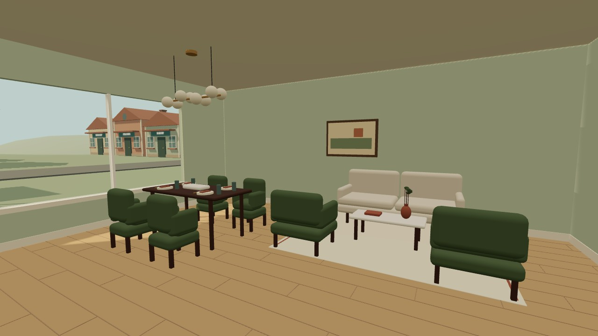
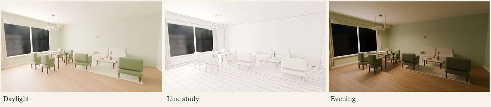

# Studio House

The seed-42 demonstration is a 15 × 16 m single-storey home with six furnished rooms and a connecting hall. The formal salon contains a conversation group and a dining group. Their reservations include the furniture and space for withdrawing the dining chairs. The study groups its desk, chair and task light together. The bedroom retains the released Belaya desk and native bedroom concepts. The additional modeled assemblies are original design studies.



## Client books

[Open revision 5 (sage)](https://github.com/ngstephen1/ArchiMind/releases/download/studio-house-r5-r6-preview/Studio-House-r5.pdf) · [Open revision 6 (terracotta)](https://github.com/ngstephen1/ArchiMind/releases/download/studio-house-r5-r6-preview/Studio-House-r6.pdf) · [Download the scenes and all proof images](https://github.com/ngstephen1/ArchiMind/releases/tag/studio-house-r5-r6-preview)



Town matches the saved project, revision, home ID and full exported manifest digest before offering a published book. Other applied designs can export their own manifest.

### First 4K salon view

[Open the 3840 × 2160 Falcon daylight image](https://github.com/ngstephen1/ArchiMind/releases/download/studio-house-r5-r6-preview/Studio-House-Salon-Daylight-4K.jpg). This frame uses the revision-5 manifest and window-aligned salon camera. Cycles ran on one NVIDIA A30 with OptiX. The salon benchmark returned 95th-percentile linear RGB errors of 0.030 at 128 samples and 0.024 at 256 against the 512-sample crop. The 0.015 threshold selected 512. Three display grades were compared from the same EXR. This JPEG uses AgX Medium High Contrast and −0.65 EV to retain separation between the sofa, chairs and pale walls. The PDFs above are CPU review prints.

## Walk through the saved design

From a checkout with the [Town dependencies](../../README.md#quick-start) installed, run the following command.

```sh
.venv/bin/python scripts/run_studio_home.py
```

Open the printed project link, choose **Visit house** and enter through the door. **Design presentation** opens the applied design. Select a room to see its photographs and its north and east schematic elevations. The board also includes the whole-home plan and furniture schedule. Download the whole-home manifest to reproduce the scene.

If you already have Town open on its default ports, launch a separate studio session.

```sh
TOWN_PORT=8828 TOWN_EDITOR_PORT=8829 .venv/bin/python scripts/run_studio_home.py
```

The launcher uses a temporary local database. Revision 5 is the replayed example. Keep this terminal open to work in that session. Run with `--edited` to replay a sixth revision in which the bedroom chair moves along the Belaya desk and the walls change from sage to terracotta. To make that edit yourself, open **Design a home** on the applied example and submit **move the bedroom desk chair and terracotta finishes**, then preview and apply its candidate. Python checks the new footprint and room connectivity before accepting the move. The revision-5 link continues to identify the original arrangement.

## Generate the presentation

The same serializer serves the Town download and the CLI. Use a fresh output directory per render. The following commands create a small review set with Blender 5.1.2 and Cycles.

```sh
mkdir -p output/studio
.venv/bin/python scripts/run_studio_home.py --export output/studio/saved.json
node frontend/realistic_viewer/town/export-home.mjs output/studio/saved.json output/studio/manifest.json
blender -b --factory-startup --python-exit-code 1 -P scripts/render_studio_home.py -- output/studio/manifest.json output/studio/proof --proof
.venv/bin/python scripts/publish_studio_board.py output/studio/proof
```

Open `output/studio/proof/index.html`. Drag the drawing slider over the salon daylight image. Compare the practical-lit evening study, then inspect the room sheets, reserved dimensions and plan positions. The linked camera studies include gray models and a bedside before/after from the same lens. Print the book at its CSS page size (A3 landscape) with browser headers and footers off. The **Studio home proof** workflow produces the HTML, PDF, PNGs, manifest, source notices, integrity receipt and packed `home.blend` as downloadable artifacts for the two revisions. [Render workflow](../../.github/workflows/studio-home.yml)

The proof uses 960 × 540 images with 16 maximum Cycles samples. For 3840 × 2160 production, omit `--proof` and pass `--gpu` on a Blender worker with NVIDIA OptiX. The production path benchmarks a fixed salon crop at 128, 256 and 512 maximum samples. It selects the first result within 0.015 of the 512-sample reference at the 95th percentile of sampled linear RGB errors. PNGs use the scene's color management and EXRs retain scene-linear pixels. The receipt records detected devices, settings, render file hashes and manifest identity. Keep the scene, images, receipts and notices together. Surface originals are optional and checked against their recorded hashes. Packaged derivatives are available offline.

## Design checks and interpretation

- Town can interpret **entertaining guests**, **quiet work** and **compact everyday living** offline. The first adds the formal salon. Available floor space matters. At seed 42 the 15 × 16 m demonstration succeeds, and the default 13 × 13 m entertaining search reports exhaustion. Quiet work changes bedroom/study priorities. Compact everyday living tests a 10.5 × 11.5 m footprint.
- The spatial validator checks accessible furnished rooms, connection through the hall, windows on exterior walls and complete partition coverage. The salon has a validated 0° or 90° seating assembly. An internal quarter turn swaps both physical extents and all part placements. The dining group retains at least 0.5 m for chair withdrawal inside its own reserved bounds. These are presentation checks. Construction, egress certification and product procurement require separate evidence.
- The five Town worker roles show executed events. They interpret a brief, look up eligible evidence, propose layouts, check geometry and prepare presentation choices. The rendering step has its own offline camera and lighting studies. Its grayscale contrast statistic measures light distribution and makes no judgment about the artistic merit of a room.
- Elevations show projected furniture reservations. Finishes are design palette samples. A/B layouts, daylight comparisons, historical bedroom releases, saved material choices and optional live model interpretation have separate purposes. The offline studio requires no API key.
