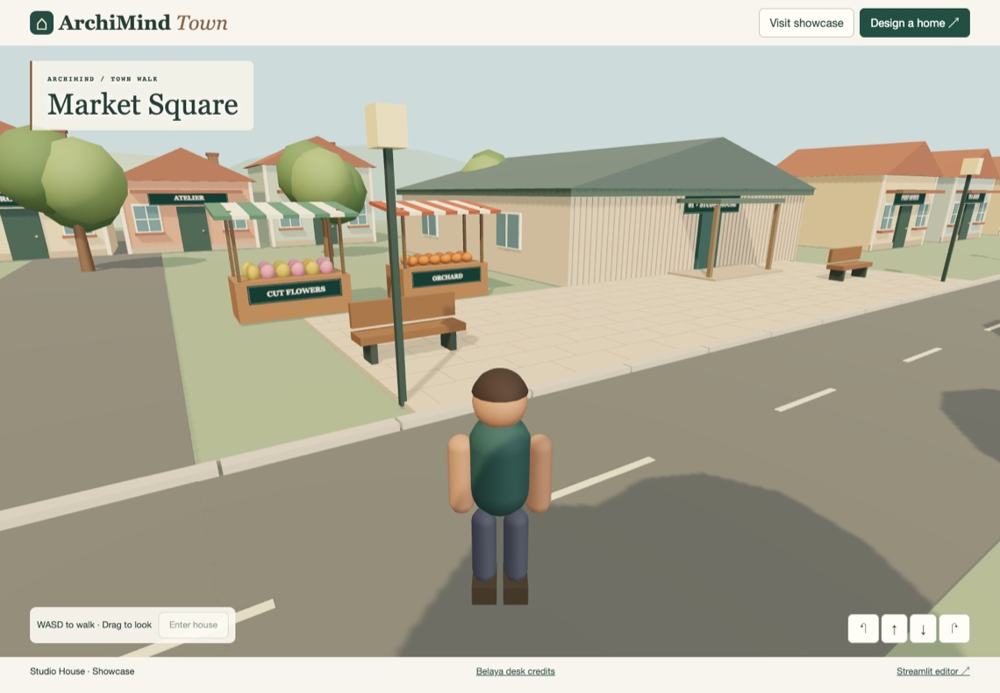
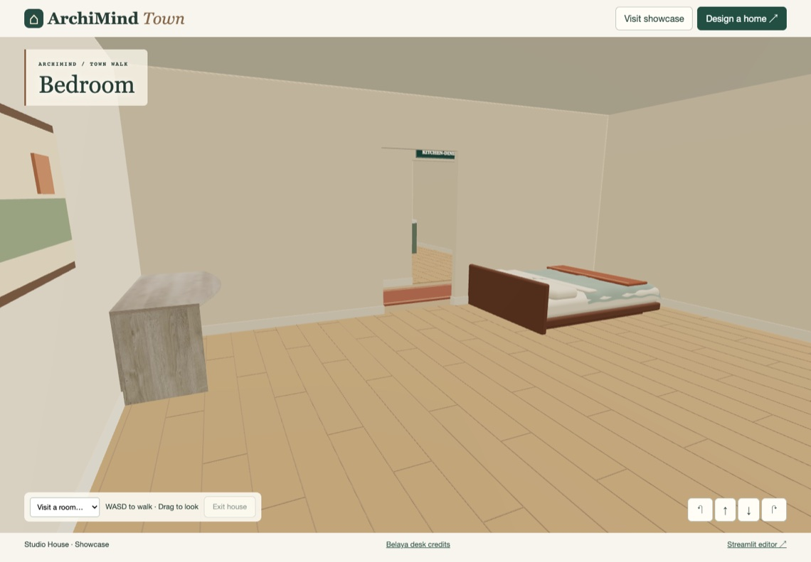
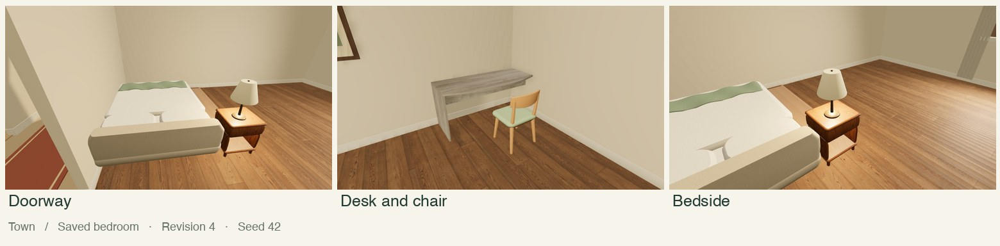
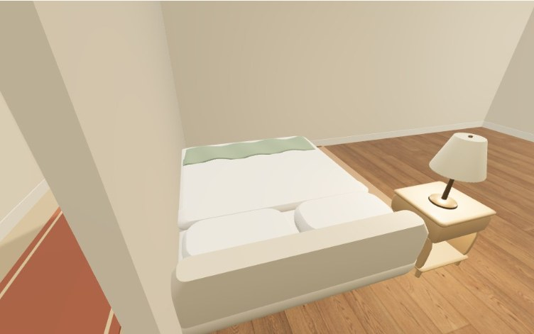

# ArchiMind Town

Market Square is a single-player, third-person walking scene with one enterable Studio House. Inside, the camera moves to eye height. A public visitor can tour the packaged house. A designer can generate alternatives on a measured lot, walk through a preview and apply a revision. The town and the Streamlit editor share the same Python API.



## Run from the repository

Use Node 20 or later and the project's Python 3.11+ environment. With dependencies already installed, only the last command is needed.

```sh
npm ci --prefix frontend/realistic_viewer
.venv/bin/python -m pip install -r services/town/requirements.txt
.venv/bin/python scripts/run_town.py
```

Open [the town](http://127.0.0.1:8790). Use WASD to walk, drag to look, and use **E** at the front door. **Visit showcase** takes you to the doorstep. In the house, **Visit a room** frames the furniture. Touch controls support walking and turning. **Design a home** opens the design panel. Try `bright study and sage finishes`, leave live interpretation off, generate and inspect A and B. Previewing an alternative leaves the saved revision intact. Choose **Apply to my home**, then follow **Streamlit editor** to inspect the same room sizes and furniture for that revision. Regenerate with **Keep these rooms** to preserve a room. From the second applied revision onwards, **Restore previous revision** saves a copy of the previous home as a new revision.

The launcher serves the town/API on port 8790 and the [standalone editor](http://127.0.0.1:8791) on 8791. It starts a worker and uses a loopback-only SQLite store at `storage/town-designer.sqlite3`. Override the file with `TOWN_DB`. Ctrl-C stops these processes. Local mode represents a single designer.

## How generation works

- The supported program is one rectangular, single-storey 9–15 m by 9–16 m home with a bedroom, study, living room, kitchen-dining room and bathroom. The seed determines the hall position, bay widths, room order, room depths and furniture search seeds. Search tries at most eight partitions and retains up to two distinct valid homes.
- **Quiet bedroom** places the bedroom behind the living room and ranks alternatives by distance from the front. **Bright study** increases the study window width. These are design proxies. Acoustic isolation and daylight simulation remain unevaluated.
- Each furnished room passes the existing layout generator and spatial validator. The whole-home check verifies that rooms and hall tile the lot, hall-facing doorways and external windows align, and a 0.6 m clearance envelope connects the entrance to an interior point in every furnished room. It does not certify a building design.
- A lock preserves a room's placement, openings and furniture. The first implementation holds all partition boundaries fixed for a locked revision and regenerates the unlocked furnishings. The palette applies to the whole home.
- The deterministic interpreter accepts complete supported clauses, including `quiet bedroom`, `bright study`, `use oak` and `keep the bedroom`. Compose with “and” or a semicolon. An unknown clause or incompatible priorities produce a message before the saved design changes. The design team’s live interpreter may return a clarification, a priority, a palette or a lock. Python constructs the partitions, resolves product evidence and validates geometry.
- Belaya uses the existing Policy B factory and an explicit render binding. The browser checks the binding, resource budgets, GLB bytes, decoded geometry, texture sizes, placement and native scale. Missing evidence or a failed download yields a labeled placeholder. The bed, other furnishings and town architecture are illustrative geometry. The house generator uses a fixed furniture program. Public dataset packs, arbitrary mesh generation and automatic furnishing of every town building remain outside this implementation.



## Hosting the town and editor separately

| Component | Entry point | Configuration |
|---|---|---|
| Vercel static town | Root `vercel.json` builds `dist/town` | Public build variables `TOWN_API_URL` (ends in `/api`), `TOWN_EDITOR_URL`, `SUPABASE_URL`, `SUPABASE_ANON_KEY`. Use the publishable/anon key only. |
| Render API | `archimind.town.api:app` | `DATABASE_URL`, `SUPABASE_URL`, `SUPABASE_ANON_KEY`, and `TOWN_ORIGIN` equal to the exact town origin. Liveness path `/health`. |
| Render worker | `python -m archimind.town.worker` | Same private Postgres database as the API. Optional provider credentials belong on the worker. |
| Streamlit editor | `streamlit run pages/Town_Editor.py` | `TOWN_API_URL`, `TOWN_SITE_URL`, and Supabase public sign-in configuration. Health path `/_stcore/health`. |
| Supabase | Auth and Postgres | Enable password sign-in and set the confirmation redirect for the frontend. Use a server role allowed to create and own the dedicated archimind_town schema. |

Render prompts for credentials on each service when the Blueprint is first created. [Render Blueprint reference](https://render.com/docs/blueprint-spec#prompting-for-secret-values)

The town ships the pinned desk and attribution with its static bundle. Keep the Vercel origin on HTTPS for browser SHA-256. Private editor links carry the project UUID and revision only. Each client signs in independently. The API verifies the bearer token with Supabase and checks project ownership. The application tables have row-level security and revoke direct access for anonymous and authenticated Supabase roles. To open a historical revision in the editor, use its revision-specific URL and select **Open latest** before editing. A stale apply receives HTTP 409.

The API reserves one of three daily design jobs per owner. Duplicate request IDs return the existing job for identical input. Queued and in-flight work can be cancelled. A failed or expired job leaves the applied home available. Town and the editor submit an AI team job on **Generate**. A job reserves three OpenAI calls before admission, including jobs that later fail or need clarification. Legacy API callers can still submit an offline job or a one-call interpretation job. The local launcher reads the server key from the environment or ignored `.env` and defaults to nine reserved calls per UTC day. The hosted API needs the studio flag and positive `TOWN_DAILY_MODEL_CALLS`, `TOWN_DAILY_MICROUSD` and `TOWN_CALL_RESERVE_MICROUSD`. The worker needs the studio flag and `OPENAI_API_KEY`. The monetary settings are operator estimates. Codex uses its own account and its usage is separate. Walking, previews, switching layouts and reopening projects require none.

## Verification

```sh
.venv/bin/python -m pytest -q tests/test_town.py
npm test --prefix frontend/realistic_viewer
node frontend/realistic_viewer/town/build.mjs
curl -fsS http://127.0.0.1:8790/health
curl -fsS http://127.0.0.1:8791/_stcore/health
```

The town tests cover twelve measured briefs, reproducible showcase output, room locks, authored product evidence, missing doors, offline text, owner isolation, stale revisions, quota reservation, a mocked provider clarification, cancellation and undo. Local Chrome checks exercised generation, application and walking at 1440 × 1000 and 390 × 844, and opening the saved revision in Streamlit. Narrow Chrome simulates a viewport. Physical-phone performance, photorealism, paid model behavior and authenticated multi-user operation on the managed hosts require separate acceptance.

A separate PostgreSQL 16 smoke test created the private schema, queued a brief, validated and applied a home, reopened the revision, and verified row security and denied client grants. A browser round trip submitted an offline brief in Streamlit, applied revision 2, opened it in the narrow town view and restored revision 1 as revision 3.

## Bedroom presentation and evidence

Inside the home, choose **Bedroom camera → Doorway**, **Desk and chair** or **Bedside**. Each lens uses the saved openings and furniture bounds. Detail cameras check framing and lines of sight inside the bedroom. For a missing subject or blocked composition, the selector explains why it is showing the doorway view. Choose **Walking view** to resume the same position and heading.

Both the browser and print presentation capture these views at 1280 × 720. Surface maps are packaged with the app. The bedside veneer and curtain linen use physical-scale UVs. The courtyard provides interior ambient reflections, while each bedroom window directs a soft light through its measured opening. The sources, licenses, derivations and hashes are listed in the [surface manifest](../../frontend/realistic_viewer/town/materials/bedroom-sources.json).



Use **Design presentation** in the town footer for the applied revision, or for the packaged showcase before applying a design. The three bedroom photographs are rendered from the same home as the dimensioned plan and furniture schedule. The material board describes the rendered bedroom finishes. Use **Print presentation** to print or save it as a PDF in the browser. Earlier saved homes retain their recorded furniture inventory.

The local explanation control supports questions about the writing station, rug and reading light. The explanations use authored rules and measurements calculated from the displayed revision. Regression tests vary furniture positions, dimensions and inventory to verify the answers. In particular the desk-to-window distance is measurable; glare depends on screen orientation, time and lighting. Bedroom Chat also shows reviewed uses, variant, material/style evidence where available, and the actual planning footprint for each search result.

The timber image is the 1k diffuse map from [Poly Haven Wood Floor](https://polyhaven.com/a/wood_floor), used under the [CC0 asset license](https://polyhaven.com/license). Its upstream MD5 is b7e927d2bf2f8f103820ff3890c8407c. Linen and plaster detail and the light at the modeled window are procedural.

## Preview a released designer chair

1. Apply a generated home. Reopen **Design a home** and expand **Bedroom designer chair**.
2. Choose a released version and select **Preview in bedroom**. Walk around the desk to inspect the backrest and upholstery. The preview uses the current saved room and leaves its furniture schedule available under **Design presentation**.
3. Reopen **Design a home**. Choose **Apply chair to my home** to save the preview as a new revision, or **Discard chair preview** to return to the saved home.
4. Open **Design presentation** to see the saved version, its native dimensions, its footprint reservation and three views of that bedroom. **Restore previous revision** can restore the earlier chair as a new revision.

The project service checks the chair's release and the saved bedroom reservation on both Preview and Apply. It accepts a release identity and the current base revision. The built Town site serves the release registry, hash-named meshes and preview images alongside the existing viewer assets. A missing or corrupt mesh leaves the procedural chair in place and the walkthrough and presentation label the fallback. Local mode uses the existing project database. The public walk-through has no private editing controls.

## Follow a design run

Open **Design a home** and submit “Design a five-room home with a quiet bedroom and a bright study.” A (OpenAI) interprets the brief while E (OpenAI) proposes a material and daylight direction. At the same time, B searches catalog evidence, C inspects the lot and D checks the starting geometry using Python. After furnishing and deterministic candidate validation, D sends north-up PNGs of the actual candidate floor plans, their IDs, the brief and the proposed styling to OpenAI for visual critique. In the local launcher E can concurrently ask the authenticated Codex CLI to review the first candidate’s bedroom. Hosted workers skip Codex. Expand each card for results, uncertainty, failure or skip reasons. Agent activity, timing and engine badges follow recorded worker events. A new-home interpretation can specify the room program. Placement locks require an applied revision. When a provider error prevents visual critique, the design team records the failed step and offers candidates that passed spatial validation. The visual and CLI observations are advice. Python validates geometry and the user chooses which candidate to apply. Reference matches are evidence for review and cannot authorize a mesh or change a furniture binding.

The working plan shows proposed partitions and furnished candidates. Final alternatives appear after validation. **Apply to my home** saves the selected alternative. The Streamlit Town editor reads the same private run. Reloading either client at the same base revision restores the event history. Short tasks can finish between polls. **Replay recorded work** in Town steps through those events at a slower pace.

### Furnish a saved bedroom

Generate a home and apply a layout. Open **Design a home → Bedroom designer furniture**, choose a piece and select **Preview in bedroom**. Reopen the design panel and choose **Apply furniture to my home** to save the next revision. Repeat to combine either writing chair with the linen platform bed and oak nightstand. **Design presentation** shows the saved pieces. **Restore previous revision** restores the prior choices. Each mesh fits the corresponding generated reservation at its original scale. Missing or corrupt mesh data leaves procedural furniture in place and adds an availability label.



## Export a bedroom presentation

From **Design presentation**, print the saved plan, three bedroom views, material board and furniture schedule, or download the revision manifest for Blender. The [bedroom presentation guide](BEDROOM_PRESENTATION.md) includes the seed-42 release and operator command for another saved project.


## Generate an illustrative concept from a saved revision

Apply a candidate, copy its project UUID and revision from the editor, then run:

```sh
.venv/bin/python scripts/render_ai_concept.py PROJECT_UUID REVISION --direction "An eye-level bedroom view with soft window light, oak and sage linen"
```

This local command makes one separately billed GPT Image edit request using the measured plan. It writes a PNG into `output/concepts/` and prints its path. The concept can depart from the model geometry. Use the measured plan and 3D views for placement decisions. The CLI uses the local Town database by default and accepts `--database` for a different local deployment. The Town job allowance applies to web jobs only.
