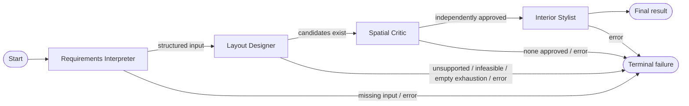

# Deterministic workflow foundation — Task 07A

This guide records the original 07A milestone and its preserved structured-input
path. Task 07B adds a separately gated
[Requirements Interpreter](REQUIREMENTS_AGENT.md). Task 07C2 adds optional
[post-critic layout advice](LAYOUT_WORKFLOW.md). Task 07D2 adds independent
[AI critique](SPATIAL_CRITIC_WORKFLOW.md); Task 07E2 adds an optional final
[Interior Stylist](INTERIOR_STYLIST_WORKFLOW.md). The default 07A CLI still runs
four deterministic nodes offline without an API key. Original milestone output
and test counts below are historical unless stated otherwise.

The default is a backend-only LangGraph workflow for four roles, each a
deterministic Python component. In that mode no LLM reasoning, natural-language parsing,
model request, C01 invocation, subprocess, chat or automatic revision is involved.
Task 07F exposes a separate selected-layout styling entry point in Streamlit,
reusing final E2 steps without invoking this full graph or generating layouts.
Default rendering geometry remains unchanged. A separate optional
[catalog-color preview](STYLE_COLOR_PREVIEW.md) consumes checked style metadata;
broader multi-agent interaction is future work.

## Dependencies and API

The runtime pins **LangGraph 1.2.18**, a non-yanked production/stable release
requiring Python >=3.10; local execution uses Python 3.11.13 and Pydantic 2.14.1.
The supported `StateGraph`, `START`/`END`, `add_conditional_edges`, `compile` and
`invoke` APIs were checked against the installed version and the official
[Graph API](https://docs.langchain.com/oss/python/langgraph/graph-api) and
[Pydantic state guide](https://docs.langchain.com/oss/python/langgraph/use-graph-api#use-pydantic-models-for-graph-state).
See [release metadata](https://pypi.org/project/langgraph/1.2.18/).

LangGraph installs its required transitive packages, including `langchain-core`
and LangSmith; no model-provider SDK or higher-level `langchain` package is added.
The runner uses the installed LangSmith `tracing_context(enabled=False)` to
disable remote tracing even when the caller enables it. No callbacks, store,
checkpointer or external service is configured. The caller's context/environment
is restored after execution. Internal LangGraph run IDs are excluded from result
data and traces; only declared seed and deterministic domain results are returned.

```python
from archimind.examples import create_sample_bedroom
from archimind.workflow import DesignRequest, WorkflowState, run_workflow

request = DesignRequest(specification=create_sample_bedroom(), seed=42)
result = run_workflow(request)
assert result.status == "succeeded"
assert WorkflowState.model_validate_json(result.model_dump_json()) == result
```

## State and responsibility contracts

| Contract | Contents and boundary |
| --- | --- |
| `DesignRequest` | Optional original prose; structured canonical `RoomDesign`; seed, 1–2 candidates, 0–10,000 attempts; canonical `AccessibilityConfig`; fixture styling preference; optional bounded `style_request` and soft preferences |
| `WorkflowState` | Original request, canonical working specification, `LayoutGenerationResult`, individual critiques, selected index and approved design, styling, stage/status, activity trace, typed error, iteration count |
| `CandidateReview` | Candidate index, newly computed `AccessibilityValidationReport`, acceptance and reason; failed/unverified reports cannot be accepted |
| `StylingPreferences` / `StylingMetadata` | Neutral/warm/cool fixture selector and explicit `deterministic_fixture` palette/material notes; no rendered materials or geometry changes |
| `AIStylingState` | Separate opt-in execution/source/status, selected target, checked E1 result/plan and sanitized fallback reason; never canonical geometry |
| `AgentActivity` / `WorkflowError` | Ordered role/decision/message records and sanitized node-specific failure codes; no timestamps, secrets or raw exception text |

Canonical IDs, dimensions and coordinates are not redefined. All geometry remains
meters from the southwest origin, X east, Y north, Z up. The original specification
is retained unchanged. The existing generator replaces requested X/Y positions;
input positions are not fixed anchors. Candidate room geometry, furniture IDs,
names, categories, dimensions and rotations must match the specification.

Malformed canonical data/options raise Pydantic `ValidationError` before graph
execution. A missing specification, including prose-only input, instead returns
a traced `missing_specification` failure. Explicit empty-furniture requests are
supported by the existing backend. No prose is interpreted or sent elsewhere.



1. **Requirements Interpreter** revalidates and copies structured requirements.
2. **Layout Designer** calls `generate_layout_candidates` exactly once with the
   requested seed/config/budget; it reuses search, scoring and geometry logic.
3. **Spatial Critic** re-runs `validate_accessibility` for every actual candidate
   with the requested config and **zero overlap tolerance**. It rejects failed or
   unverified checks, changed specifications and disagreement with supplied reports.
   It selects the first approved candidate in the generator's ranked order.
   Advisory door-clearance warnings remain advisory and are preserved in reports.
4. **Interior Stylist** attaches deterministic fixture metadata to that approved
   design. It does not alter candidate coordinates, reports, scores or assets.

## Bounds, failures and serialization

The default has one generation iteration and four node executions. All edges
advance or terminate; there is no retry/back edge. A guard rejects a second
generation iteration. Current E2 bounds allow seven nodes with both advisory
nodes, attempted AI styling and a fixture fallback; recursion limit 9 is an extra
backstop. AI styling success replaces the fixture. The default still executes
four; see the [stylist workflow guide](INTERIOR_STYLIST_WORKFLOW.md) for all modes.
The generator retains its 32-furniture/10,000-attempt and accessibility limits;
the workflow introduces no alternative placement/geometry implementation.

Outcomes are `succeeded`, `failed`, `unsupported`, `infeasible`, `exhausted` or
`rejected`; `pending`/`running` describe intermediate states. Search exhaustion
does not prove infeasibility. A partial result with one valid candidate can still
complete the workflow; its original `search_exhausted` generation status remains
visible. With no candidate, exhaustion terminates before critique/styling.

Node exceptions terminate immediately with a sanitized `node_error`, retaining
the preceding trace. Failure clears the selected/approved design and styling,
including when a styling exception follows a successful critique. Completed
handoffs and the final result are explicitly Pydantic-validated because LangGraph
does not automatically validate every node/output update. Success requires an
existing, independently approved selection and completed styling.

No mutable workflow singleton exists. Caller input and API arguments are copied;
each invocation builds a fresh graph and state. JSON includes all original data,
candidate layouts, independent reports, decisions and fixture metadata. Repeated
fixed-seed invocations return identical domain output, including trace messages.

## Reproducible CLI demonstration

```bash
cd /Users/macbook/Hack/ArchiMind
source .venv/bin/activate
python -m archimind.examples.workflow_bedroom
python -m archimind.examples.workflow_bedroom --seed 42 --theme warm --json
```

Actual default output:

```text
Task 07A deterministic workflow (no LLM calls)
Status: succeeded
Generation: complete; 2 candidates; 9/500 attempts
Selected candidate: 0 (zero-based)
Independent spatial checks: passed
  desk: X/Y (0, 1.36) m; W/D/H 1.2/0.6/0.75 m
  queen-bed: X/Y (3.4, 1.69) m; W/D/H 1.6/2/0.6 m
  wardrobe: X/Y (0, 3.4) m; W/D/H 1.5/0.6/2 m
Styling: neutral (deterministic_fixture)
Trace:
  1. requirements_interpreter [accepted] Accepted structured room and 3 furniture requests.
  2. layout_designer [generated] Generated 2 candidate(s) in 9 attempt(s); generator outcome: complete.
  3. spatial_critic [approved] Reviewed 2 candidate(s); selected approved candidate 0 (zero-based).
  4. interior_stylist [styled] Attached deterministic neutral styling metadata; geometry unchanged.
```

`--json` prints the complete typed state. Exit code 0 means workflow success,
1 means a terminal workflow failure, and 2 means invalid CLI arguments. For a
bounded failure demonstration use `--max-attempts 0`: status `exhausted`, no
approved design, two trace entries and exit code 1. CLI output is not persisted
unless the caller explicitly redirects it.

## Verification and remaining scope

`tests/test_workflow.py` has 38 offline cases using real LangGraph, Shapely and
generator APIs, plus controlled fault injection. They cover order/handoffs,
forged/failed/unverified reports, preserved identities and dimensions, a valid
second candidate, partial/unsupported/infeasible/exhausted outcomes, iteration
bounds, exceptions, styling immutability, concurrent isolation, JSON round-trip,
tracing suppression and real CLI exit/JSON behavior. In-process workflow tests
block socket connections/DNS and fail on attempted network access.

Final local checks: **631 passed in 23.75s** (593 prior + 38 workflow), all **27
frontend tests passed**, syntax/build passed with unchanged bundles. Editable
installation and `pip check` passed; Ruff lint/format passed (56 Python files).
The real headless Streamlit health check returned **HTTP 200 ok**.
Wheel contents include all workflow modules and the CLI, with the pinned LangGraph
dependency in metadata. The readable CLI output above was checked against execution.

```bash
python -m pip install -e ".[dev]"
python -m pytest -q
python -m pip check
python -m ruff check .
python -m ruff format --check .
python scripts/check_health.py
npm --prefix frontend/realistic_viewer test
npm --prefix frontend/realistic_viewer run check
npm --prefix frontend/realistic_viewer run build
```

Limits remain those of the existing conservative spatial engine: rectangular,
single-room, zero-rotation layouts, rectangular door approaches, square-occupant
circulation, no ergonomic/height/function or architectural code certification.
No natural-language intelligence, model provider, UI integration, persistence,
automatic retries/revisions or real styling assessment is delivered here.

Task 07B is now implemented separately; see the
[Requirements Interpreter guide](REQUIREMENTS_AGENT.md).
Task 07C1 adds [standalone layout advice](LAYOUT_AGENT.md). Task 07C2 now adds an
explicitly opted-in [advisor route](LAYOUT_WORKFLOW.md) after critique, with safe
fallback and selection provenance. Task 07D1 adds a standalone
[AI design critic](SPATIAL_CRITIC_AGENT.md), now integrated as an optional advisory
node by [Task 07D2](SPATIAL_CRITIC_WORKFLOW.md). Default structured execution remains
deterministic. E1 adds the standalone [Interior Stylist](INTERIOR_STYLIST_AGENT.md),
without replacing the fixture or changing routing. Task 07E2 adds the
[optional final stylist route](INTERIOR_STYLIST_WORKFLOW.md); Task 07F exposes
selected-layout styling separately in Streamlit.

## Qualified furniture metadata — Task 08B

`archimind.assets` is an independent, offline product catalog. Neither
`run_workflow()` nor the active UI reads it. It adds no retrieval, embedding,
generation, rendering or agent integration. The source qualification record is
[Task 08A](../data/FURNITURE_SOURCE_REGISTER.md).

The packaged catalog `archimind-furniture`, version `1.0.0`, schema `1`, contains
two metadata-qualified records:

| Stable asset ID | Category / subtype | Width × depth × height (m) |
| --- | --- | --- |
| `abo-b075x2x4xs-amazon-com` | chair / armchair, Sod variant | 0.9906 × 0.9906 × 0.9652 |
| `abo-b07pqs58xn-amazon-com` | storage / bookcase, Espresso variant | 0.659892 × 0.381762 × 1.891792 |

These are reviewed ABO-published item measurements, not independent metrology.
Original inch measurements, explicit width/length/height axis assignments,
source snapshots, product/variant identity and CC BY 4.0 attribution are retained.
The unknown dataset revision stays null; the separate 08A qualification commit
and evidence hashes are known. Bookcase does not mean wardrobe. No bed, desk or
wardrobe is qualified, and Sheen Chair remains a separate illustrative fixture.

```python
from archimind.assets import furniture_from_catalog, load_catalog

catalog = load_catalog()  # fixed importlib.resources JSON; no path/URL argument
record = catalog.get_record("abo-b075x2x4xs-amazon-com")
proposed = furniture_from_catalog(
    record.asset_id,
    furniture_id="new-chair",
    name="Charles armchair",
    x_m=1.0,
    y_m=2.0,
)
assert proposed.rotation_deg == 0
assert record.render_qualified is False
```

The factory returns fresh canonical `Furniture`; positions retain the southwest
origin, X east, Y north and meters. Finite negative/out-of-room positions remain
representable. This is a proposed specification, not approval that it fits.
Only a later explicit generation/validation operation can establish spatial
validity. Existing layouts, geometry rules, reports and scores are never edited.

Records and their nested containers are immutable. The loader fails completely
on malformed JSON, duplicate keys/IDs, unsupported versions, missing evidence,
conflicting categories/variants, uncertain rights or incorrect conversions.
Source URLs are inert evidence references and are never fetched. Validation
checks recorded consistency; source qualification rests on the reviewed 08A
evidence, not an online truth check or a cryptographic attestation of a supplier.

Both records have `qualification="metadata_qualified"` and render status
`not_evaluated`. Model hash, local GLB path, verified bounds/orientation/anchor
and render-asset binding are null. Source-reported glTF conventions are labeled
uninspected. 08B rejects render-qualified claims and non-null render evidence;
08C must introduce and verify its complete rendering contract. A source GLB URL
is not a renderable asset, and no new model bytes have been acquired.

### Future retrieval contract

The following is future architecture. 08B implements only the authoritative
catalog lookup and specification factory.

```mermaid
flowchart LR
    Q[Natural-language query] --> I[Structured intent]
    I --> F[Hard eligibility and category filters]
    F --> S[Semantic and keyword retrieval]
    S --> C[Authoritative catalog lookup]
    C --> D[Dimension compatibility]
    D --> G[Explicit layout generation]
    G --> V[Deterministic spatial validation]
    V --> R[Approved asset rendering]
```



`record.search_document()` has a fixed version-1 format and deterministic
alias/tag ordering. It includes reviewed names, category/subtype, usage,
variant and identifiers. Original marketing titles stay in provenance. The two
records have unknown descriptions, materials, colors and styles (`None`), so
these are omitted. Sod/Espresso are variant labels, not inferred physical colors.
An attribute requires separate reviewed source-field evidence; marketing titles,
appearance inference and AI-generated enrichment cannot qualify it.

Future index entries must retain this immutable reference:

```python
index_key = (
    catalog.catalog_id,
    catalog.catalog_version,
    record.asset_id,
    record.asset_version,
    catalog.search_document_version,
    record.search_document_sha256,
)
```

Embeddings/keyword indexes are derived caches. Resolve every hit back to the
authoritative versioned catalog, then enforce license, category and dimension
compatibility. Never reuse published catalog/record versions for changed data;
bump the search-document version for a changed text contract. Numeric dimensions
remain structured fields. Similarity cannot override rights or geometry, and
only separately render-qualified assets may be loaded for realistic rendering.
No vectors, model downloads, semantic matching, vector database, SQLite index or
live service are implemented here.

```bash
python -m pytest -q tests/test_asset_catalog.py tests/test_asset_catalog_packaging.py
```

The focused suite blocks network/client/process operations. The separate packaging
test intentionally runs the existing offline build/install toolchain, checks
source/wheel resource inclusion and unchanged legacy assets, then loads the wheel
outside the repository with network/process audit guards.
