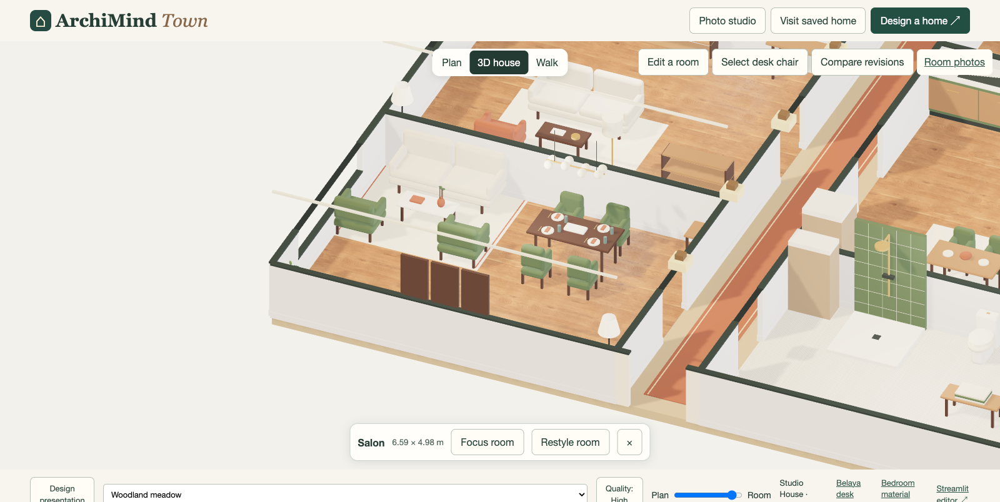
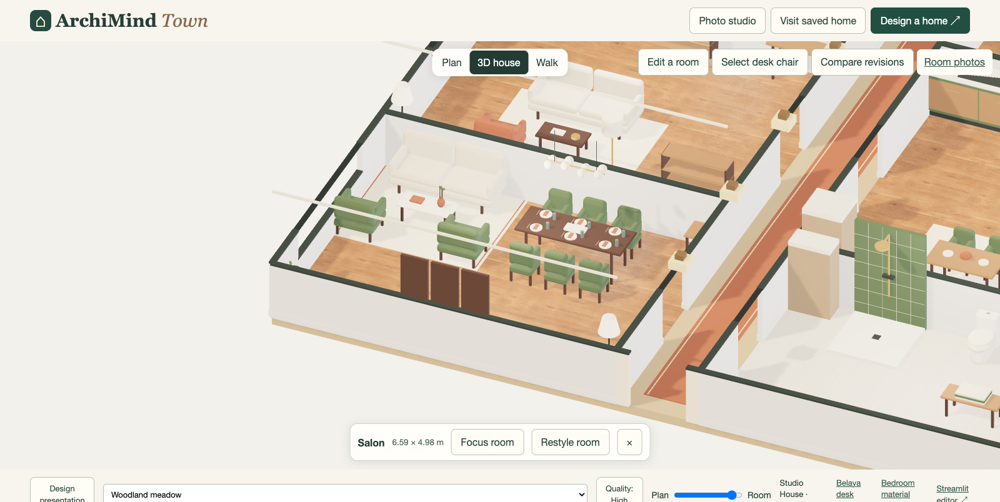
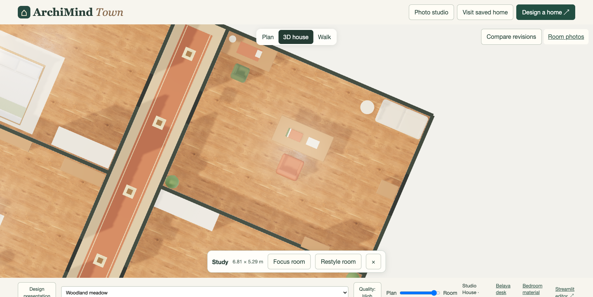
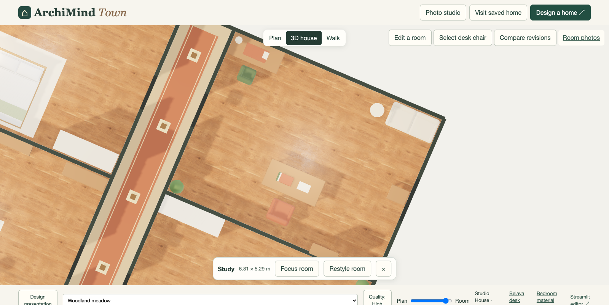

# Rehearse the woodland room edits

[Walkthrough (100 seconds)](walkthrough.mp4). The salon edit begins at 0:41 and the study edit at 1:08.

From a development checkout with the Town dependencies installed, run the following in one terminal. This creates an editable project from the furnished example in a separate local database and prints its URL.

```sh
mkdir -p storage
export TOWN_DB="$PWD/storage/woodland-rehearsal.sqlite3"
env -u DATABASE_URL TOWN_MODE=local .venv/bin/python - <<'PY'
import json
from pathlib import Path
from archimind.town import service
from archimind.town.design import validate_home

home = json.loads(Path("docs/data/furnished-residence/home.json").read_text())
validate_home(home)
service.initialize()
project = service.create("local-designer", home=home)["project"]
print(f"http://127.0.0.1:8790/?project={project}&revision=1&setting=meadow")
PY
.venv/bin/python scripts/run_town.py
```

1. Open the printed URL. Choose **3D house**, select the salon, and choose **Focus room** to see the original four seats.
2. Choose **Edit a room** and select **Six-seat salon**. Check the edit, then save revision 2. Reopen the salon from the same view to inspect three chairs on each side of one table.
3. Focus the study. Choose **Edit a room** and select **90 cm study passage**. Check the edit, then save revision 3. The folio table and chair translate together, opening a straight route from the door to the window-side table.
4. To compare, open two copies of the project URL with the adjacent revision numbers. Use the same view and room focus in both. Field measurements are still needed to verify clearance in a built room.

| Room | Before | After |
|---|---|---|
| Salon |  |  |
| Study |  |  |
